<div align="center">

<a href="https://sixteen1-6.github.io/my-collector-concierge/"></a>

# My Collector Concierge

**Your collection, thoughtfully handled.**<br>
From the moment your cards arrive to the day they come home, we help you know what you have and decide what comes next.

[](https://sixteen1-6.github.io/my-collector-concierge/)
[](https://sixteen1-6.github.io/my-collector-concierge/portal.html)

</div>

---

Two pages, one brand:

- **[The website](https://sixteen1-6.github.io/my-collector-concierge/)**: services, the four-step process, pricing and vault plans, an estimate builder, and a case of real scanned cards.
- **[The collector portal](https://sixteen1-6.github.io/my-collector-concierge/portal.html)**: a demo sign-in, then a full portal over a real sample collection. Select **Continue with the demo account**.

## The website

<table>
<tr>
<td width="50%"><a href="docs/screenshots/01-hero.jpg"></a></td>
<td width="50%"><a href="docs/screenshots/02-process.jpg">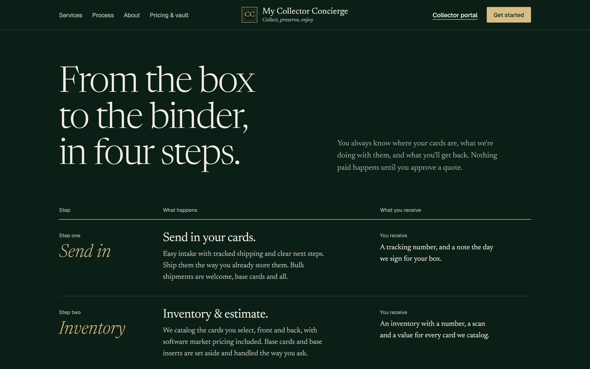</a></td>
</tr>
<tr>
<td><b>The slab label.</b> The headline sits in a grading-slab label over the velvet case, with starting prices underneath like the back of a card.</td>
<td><b>How it works.</b> Send in, inventory, choose, keep close. What happens at each step and what you get back.</td>
</tr>
<tr>
<td><a href="docs/screenshots/04-services.jpg">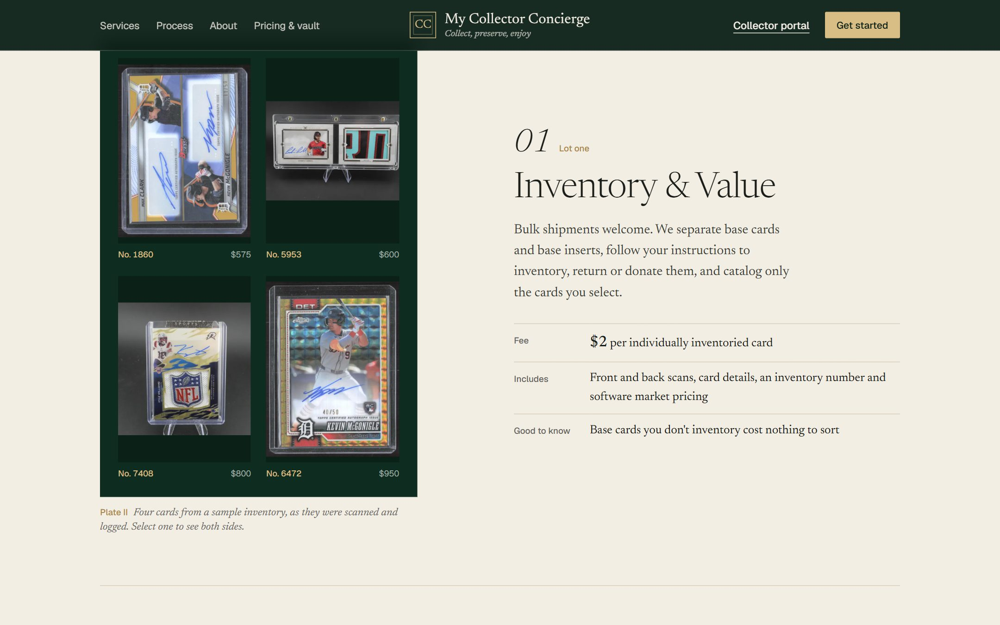</a></td>
<td><a href="docs/screenshots/05-case.jpg">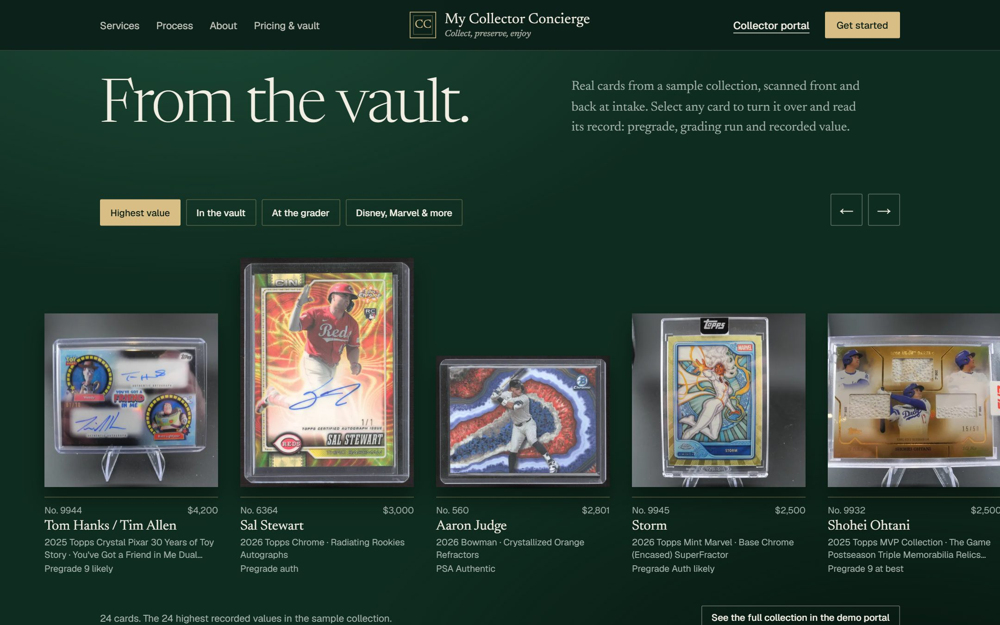</a></td>
</tr>
<tr>
<td><b>The next chapter for each card.</b> Seven services in a card-back stat table, with member prices.</td>
<td><b>From the vault.</b> Real cards, scanned front and back at intake. Select one to turn it over and read its record.</td>
</tr>
<tr>
<td><a href="docs/screenshots/06-viewer.jpg">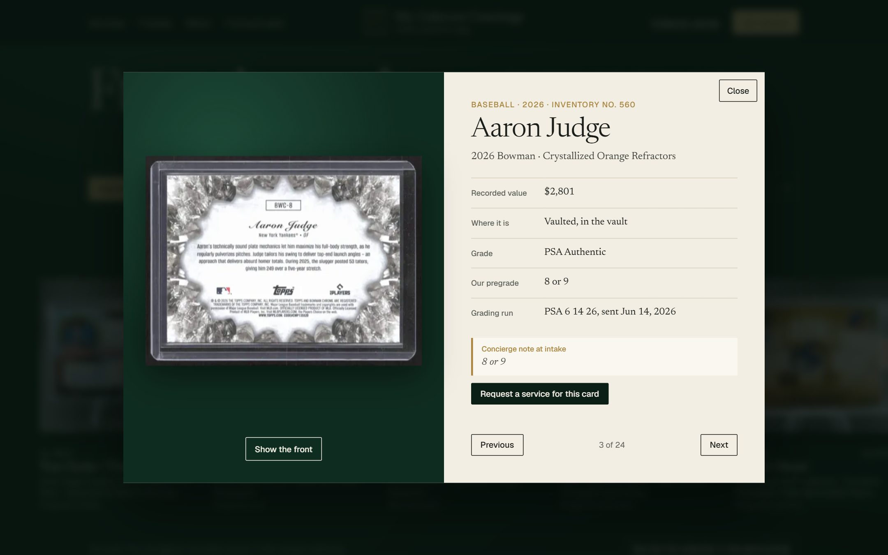</a></td>
<td><a href="docs/screenshots/07-estimate.jpg">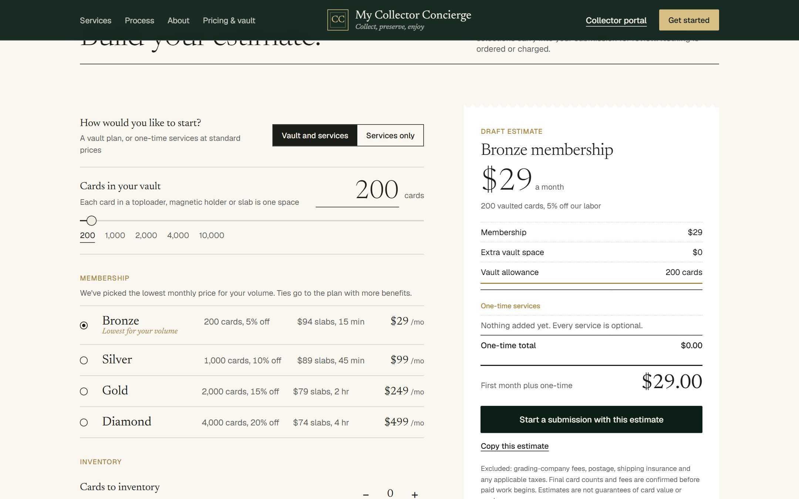</a></td>
</tr>
<tr>
<td><b>Turn it over.</b> Inventory number, recorded value, grade, pregrade, grading run and intake notes.</td>
<td><b>Build your estimate.</b> Picks the cheapest vault plan for your volume and prices every service. Starting a submission carries it into the portal.</td>
</tr>
</table>

### Scroll through How it works

<a href="https://sixteen1-6.github.io/my-collector-concierge/#how">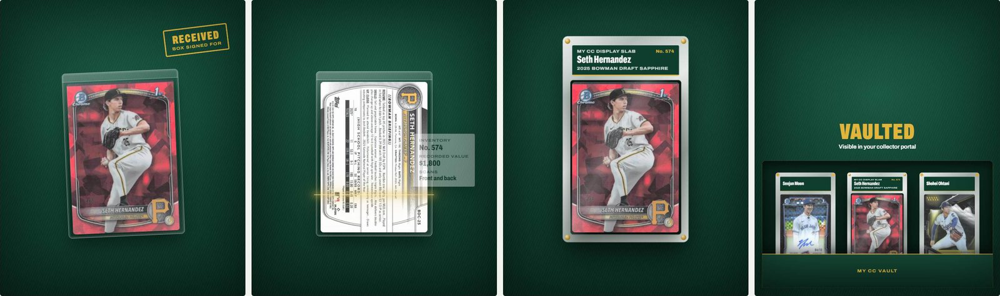</a>

The four steps are told with one real card from the collection, a Seth Hernandez Bowman Draft Sapphire (inventory No. 574). As you scroll it arrives in its toploader, gets scanned front and back, comes out of the toploader into a riveted display slab, and drops into a vault drawer next to two other vaulted cards. Scrolling is smoothed with [Lenis](https://github.com/darkroomengineering/lenis). Visitors with reduced motion turned on, and screens too short for the scene, get the plain four-column steps.

## The collector portal

<table>
<tr>
<td width="50%"><a href="docs/screenshots/09-login.jpg">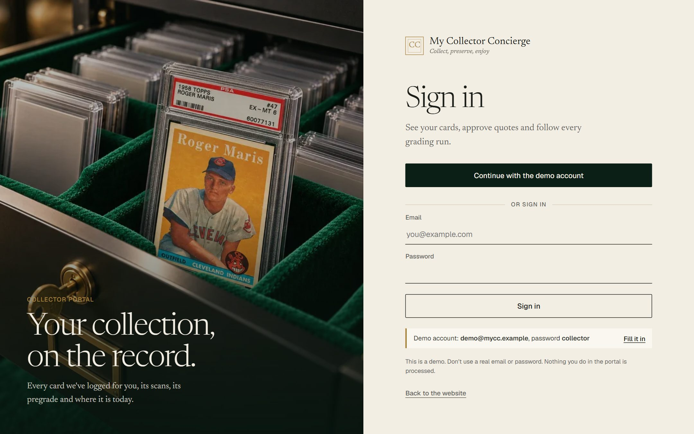</a></td>
<td width="50%"><a href="docs/screenshots/10-portal-overview.jpg">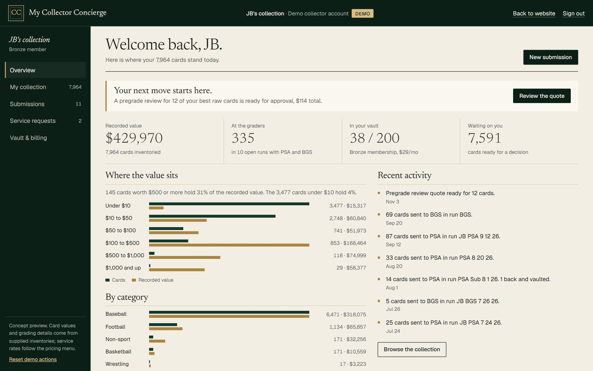</a></td>
</tr>
<tr>
<td><b>Sign in.</b> One click with the demo account, or type demo@mycc.example and the password collector.</td>
<td><b>Overview.</b> Recorded value, cards at the graders, vault space, where the value sits and recent activity.</td>
</tr>
<tr>
<td><a href="docs/screenshots/12-portal-ledger.jpg">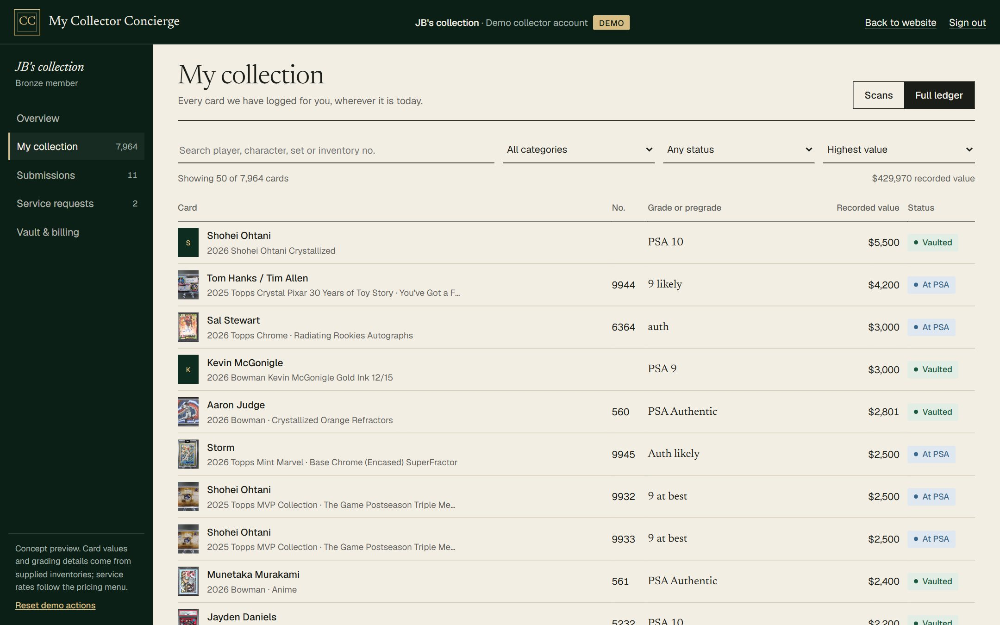</a></td>
<td><a href="docs/screenshots/13-portal-runs.jpg">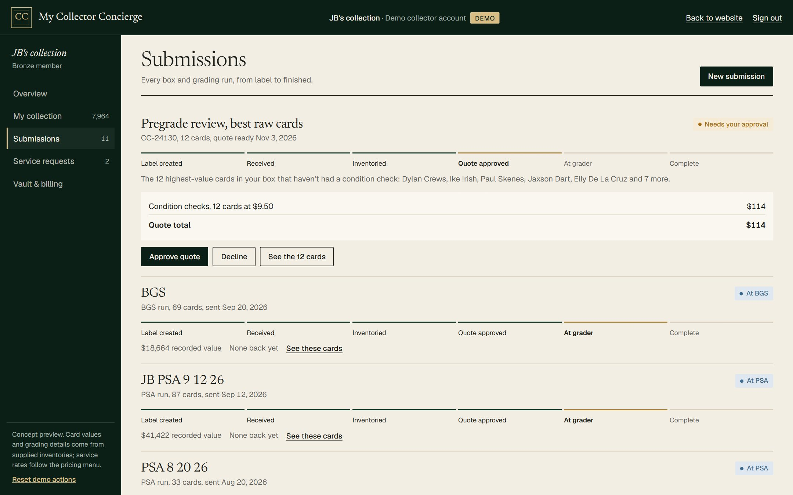</a></td>
</tr>
<tr>
<td><b>The full ledger.</b> Search 7,964 cards by player, set or inventory number. Filter by category, status or grading run.</td>
<td><b>Submissions.</b> Twelve real PSA and BGS runs with stage tracking, and a quote to approve or decline.</td>
</tr>
</table>

<p align="center">
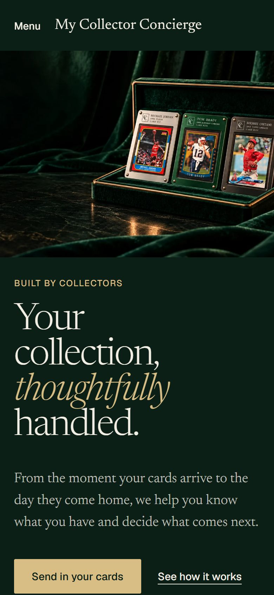&nbsp;
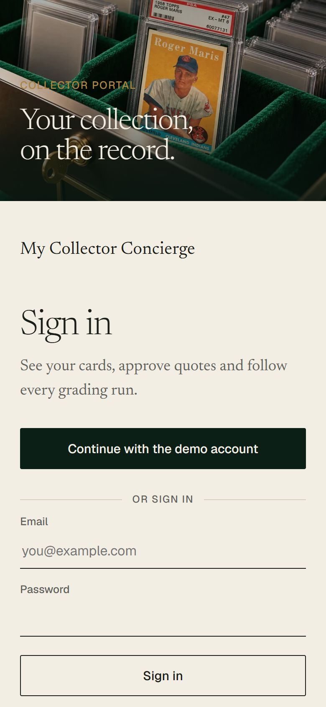&nbsp;
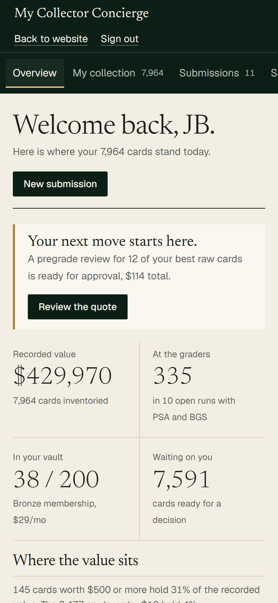
</p>

### The sample collection in the portal

| Cards inventoried | Recorded value | At PSA and BGS | Vaulted | Grading runs | Scanned for the demo |
|---:|---:|---:|---:|---:|---:|
| **7,964** | **$429,970** | **335** | **38** | **12** | **96** fronts, **88** backs |

## The services

| | Service | Fee |
|---|---|---|
| 01 | Inventory and value | $2 per individually inventoried card, with scans and market pricing |
| 02 | Condition check | $10 per card; included with grading |
| 03 | Professional grading (PSA, BGS, SGC, CGC) | $25 / $35 / $65 / $125 by value band, grader fees separate, no gem-mint fee |
| 04 | Collector display slab | $99, or $74 to $94 for members |
| 05 | Vault memberships | Bronze $29 (200 cards), Silver $99 (1,000), Gold $249 (2,000), Diamond $499 (4,000) |
| 06 | Return to you | $5 a shipment plus $0.25 a returned card |
| 07 | Consignment on eBay or Fanatics Collect | 10% of the sale, $10 minimum per sold card |

## Technology proposal

[docs/PROPOSAL.md](docs/PROPOSAL.md) answers JB's list of topics for building the real product: the website, portal and iPhone and Android apps on AWS in TypeScript, the integrations (Card Ladder, PSA, Stripe, QuickBooks, eBay, Fanatics Collect, EasyPost), hosting, security, traceability, ownership, phases, costs and support.

## Run it locally

It's static HTML, CSS and JavaScript with no build step:

```bash
python -m http.server 8000
```

Open http://localhost:8000 for the website and http://localhost:8000/portal.html for the portal. Portal actions are saved in your browser only.

## What's in here

```
index.html              the website
portal.html             the collector portal (demo sign-in)
assets/site.css         shared styles
assets/common.js        shared helpers and the card viewer
assets/home.js          the estimate builder
assets/portal.js        the portal app and demo sign-in
assets/motion.js        smooth scrolling, reveals and the How it works scroll scene
assets/lenis.min.js     Lenis 1.3.4 (MIT), self-hosted
assets/data.js          the 96 showcased cards and collection totals
data/collection.json    the full 7,964-card ledger, loaded by the portal
cards/                  front (123.webp) and back (123b.webp) scans
img/                    photography, social preview and favicon
docs/screenshots/       the images above
```

<sub>The collector portal is a demo. Estimates do not authorize paid work, and nothing in it is processed.</sub>
