<div align="center">

<a href="https://sixteen1-6.github.io/my-collector-concierge/">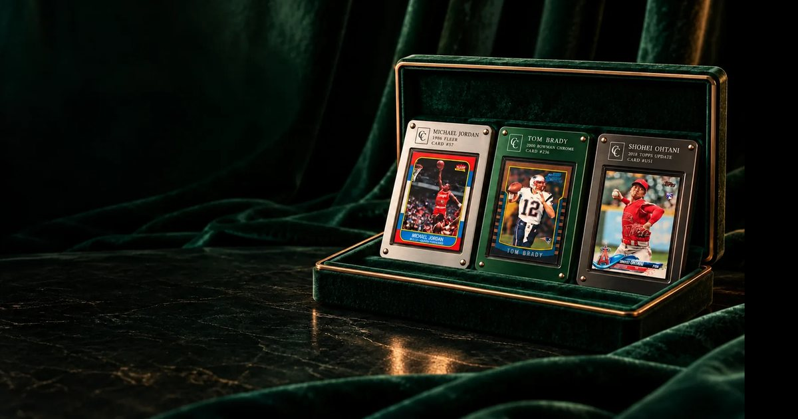</a>

# My Collector Concierge

**Your collection, thoughtfully handled.**<br>
Send us the box. We inventory it card by card, and you decide what each card deserves.

[](https://sixteen1-6.github.io/my-collector-concierge/)
[](https://sixteen1-6.github.io/my-collector-concierge/#portal)
[](docs/BRIEF.md)

</div>

---

### On file today

| Cards inventoried | Recorded value | At PSA and BGS | In the vault | Grading runs | Scanned for the demo |
|---:|---:|---:|---:|---:|---:|
| **7,964** | **$429,970** | **335** | **38** | **12** | **96** fronts, **88** backs |

These are JB's real numbers, taken from the inventory the original site shipped with. The portal searches every one of those cards.

---

## What's on the page

<table>
<tr>
<td width="50%"><a href="docs/screenshots/01-hero.jpg">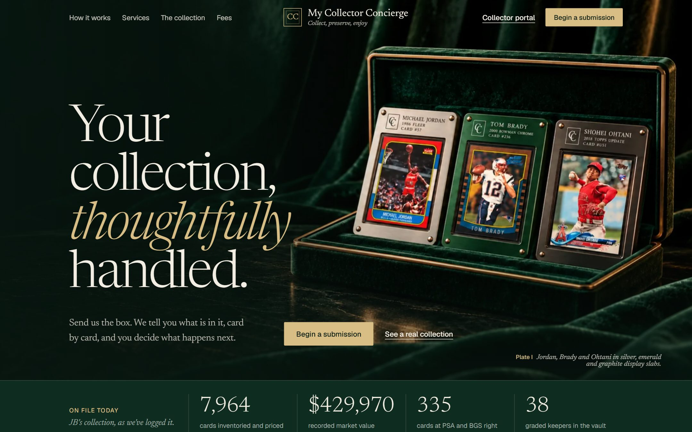</a></td>
<td width="50%"><a href="docs/screenshots/02-case.jpg">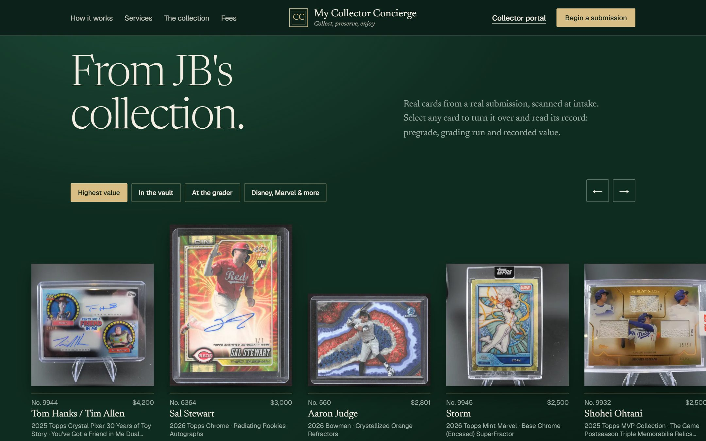</a></td>
</tr>
<tr>
<td><b>The plate.</b> Full-bleed studio photography of the riveted display slabs, with the collection's live totals underneath.</td>
<td><b>The case.</b> A velvet tray of JB's real cards. Filter by highest value, vaulted, at the grader, or Disney, Marvel and more.</td>
</tr>
<tr>
<td><a href="docs/screenshots/03-viewer-front.jpg">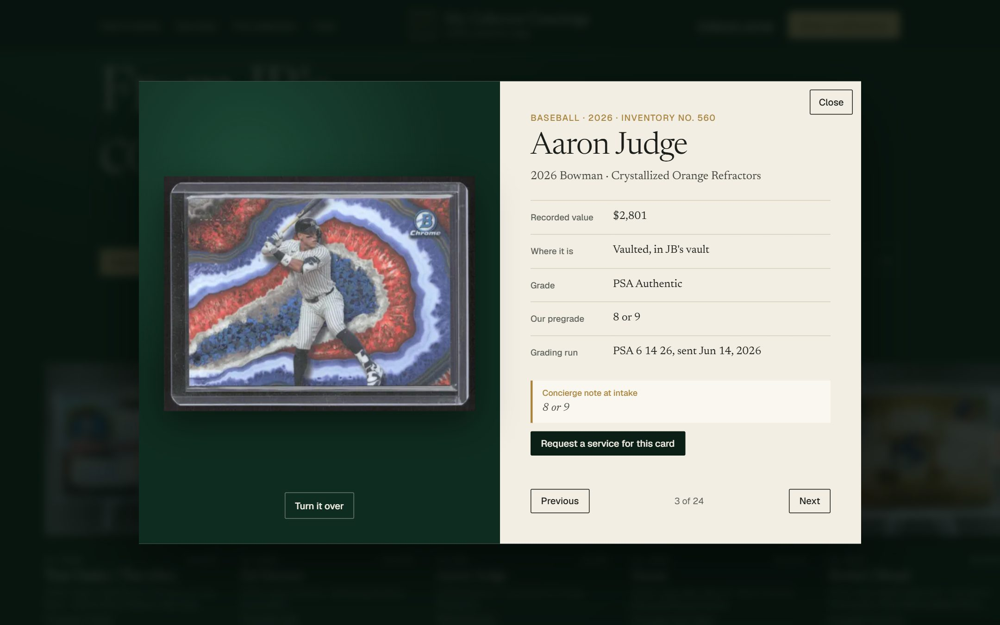</a></td>
<td><a href="docs/screenshots/04-viewer-back.jpg">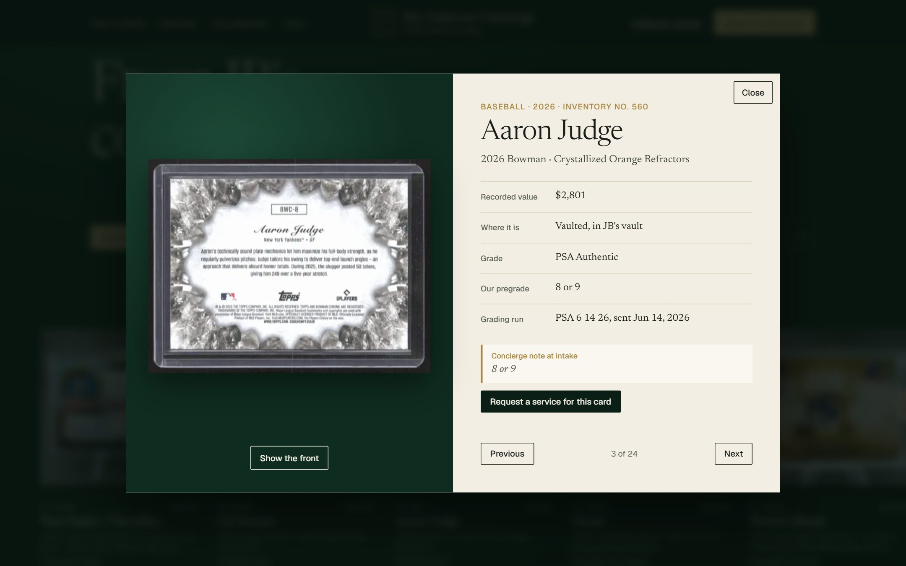</a></td>
</tr>
<tr>
<td><b>Turn it over.</b> Every card opens in a viewer with its record: inventory number, recorded value, grade, our pregrade, grading run and intake notes.</td>
<td><b>Front and back.</b> The card flips in 3D to its back scan. Arrow keys step through the set.</td>
</tr>
<tr>
<td><a href="docs/screenshots/06-portal-overview.jpg">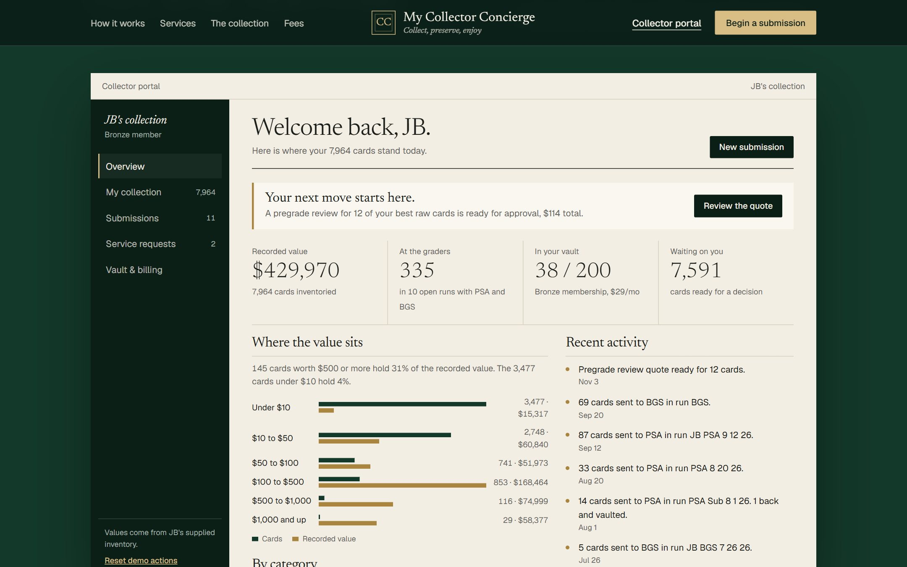</a></td>
<td><a href="docs/screenshots/08-portal-ledger.jpg">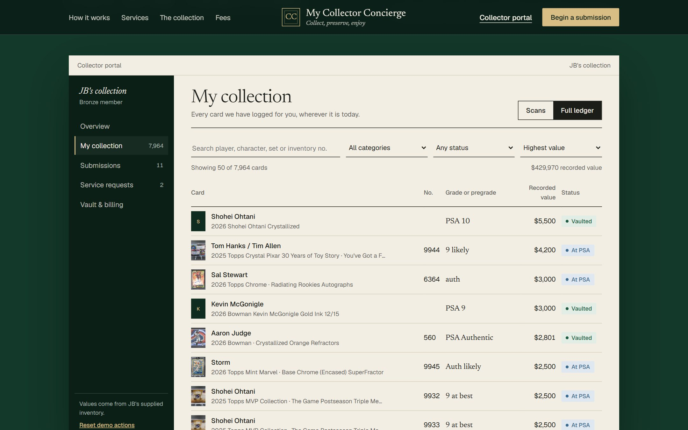</a></td>
</tr>
<tr>
<td><b>Collector portal.</b> Where the value sits (145 cards worth $500 or more hold 31% of it), the pending quote, and recent grading-run activity.</td>
<td><b>The full ledger.</b> Search and sort all 7,964 cards by player, set or inventory number. Filter by category, status or grading run.</td>
</tr>
<tr>
<td><a href="docs/screenshots/09-portal-runs.jpg">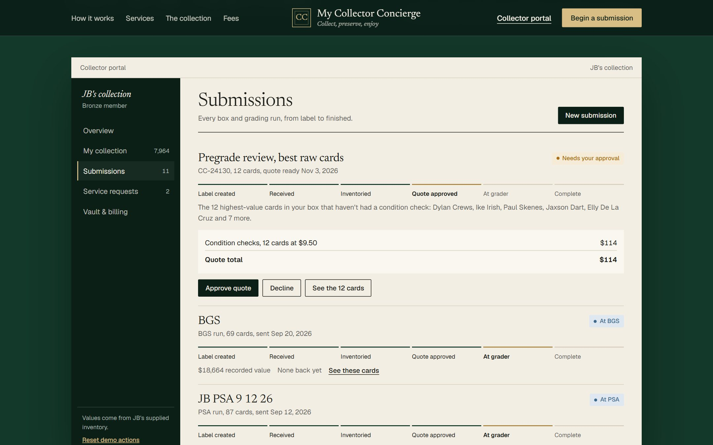</a></td>
<td><a href="docs/screenshots/10-estimate.jpg">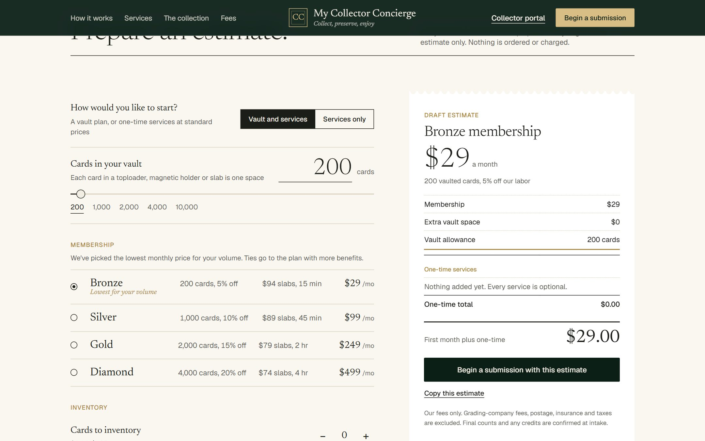</a></td>
</tr>
<tr>
<td><b>Submissions.</b> All 12 real PSA and BGS runs with stage tracking, plus a quote to approve or decline.</td>
<td><b>Estimate builder.</b> Picks the cheapest vault plan for your volume and prices every service. Starting a submission sends it to the portal.</td>
</tr>
</table>

<p align="center">
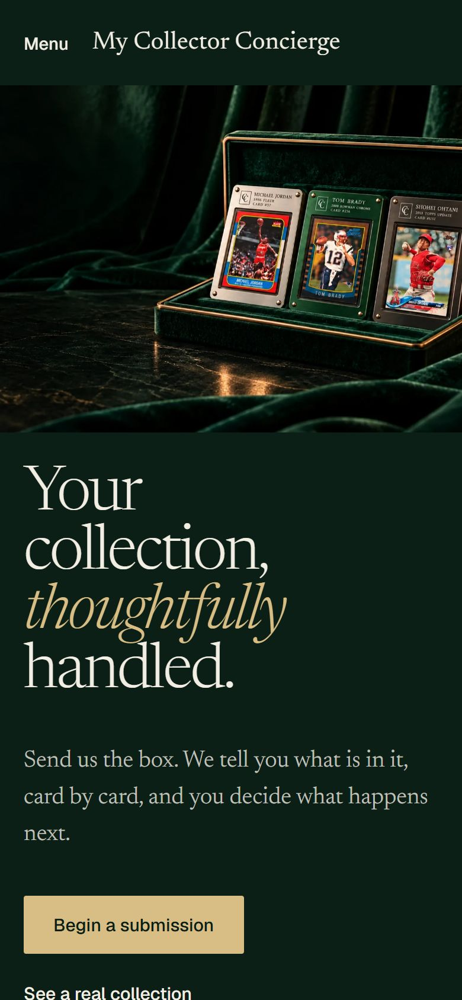&nbsp;
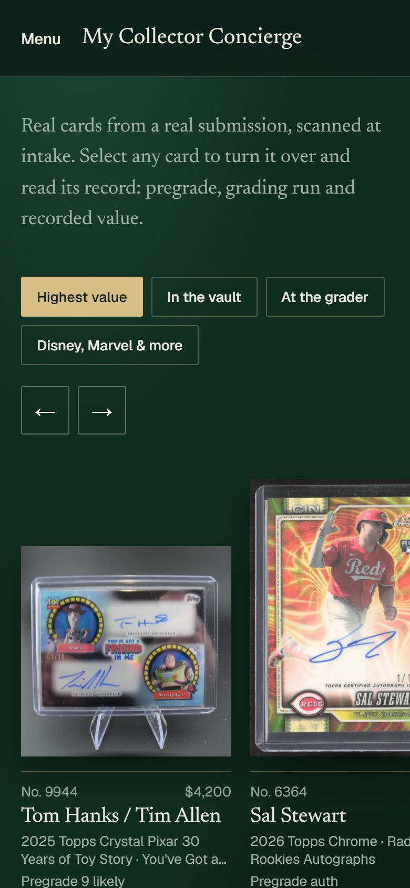
</p>

## The services

| Lot | Service | Fee |
|---|---|---|
| 01 | Inventory and value | $2 per card, front and back scans, market pricing |
| 02 | Condition check | $10 per card, centering, corners, edges, surface and a grade range |
| 03 | Professional grading (PSA, BGS, SGC, CGC) | $25 / $35 / $65 / $125 by value band, grader fees at cost, no gem-mint fee |
| 04 | Vault membership | Bronze $29 (200 cards), Silver $99 (1,000), Gold $249 (2,000), Diamond $499 (4,000) |
| 05 | Return to you | $5 a shipment plus $0.25 a card |
| 06 | Consignment on eBay or Fanatics Collect | 10% of the sale, $10 minimum |
| 07 | Collector display slab | $99, or $74 to $94 for members |

## For development partners

This repository is the approved design and a working front-end prototype. It has no backend yet. We're looking for a team to build the real product: the website, collector portal and iPhone and Android apps on one backend, with Card Ladder, PSA, payments, eBay, Fanatics Collect and shipping integrations.

**Read [the developer brief](docs/BRIEF.md)** and reply to its numbered questions.

## Run it locally

It's static HTML. Any file server works:

```bash
python -m http.server 8000
```

Then open http://localhost:8000. Portal actions (approving a quote, requesting a service, changing plan) are saved in your browser only.

## What's in here

```
index.html              the whole site: styles, scripts and the 96 showcased cards inline
data/collection.json    the full 7,964-card ledger, loaded by the portal
cards/                  front (123.webp) and back (123b.webp) scans, resized for the web
img/                    studio photography and the social preview image
docs/BRIEF.md           the developer brief
docs/screenshots/       the images above
```

<sub>The portal is a demo. Estimates do not authorize paid work, and nothing in it is processed.</sub>
