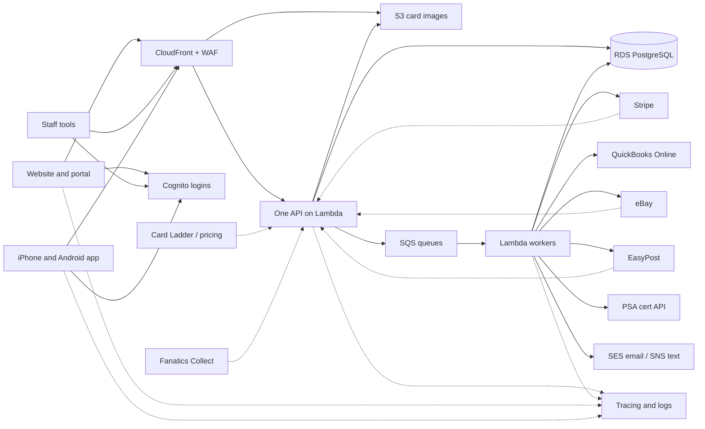

# My Collector Concierge: Technology Proposal

Prepared for JB by [your name] · [date]

I built the approved My CC website and collector portal prototype (https://github.com/Sixteen1-6/my-collector-concierge, live demo at https://sixteen1-6.github.io/my-collector-concierge/). It already runs on your real inventory: 7,964 cards with about $429,970 in recorded value. 335 of those cards are out for grading (261 at PSA, 74 at BGS), 38 are back and vaulted, and 96 have scans in the demo. Today it is a front end only, with one HTML page and one static data file. This proposal covers what it takes to turn it into the system My CC runs on: the website, collector portal, staff tools, iPhone and Android apps, integrations, hosting, security, ownership, the build plan, costs and support.

My recommendation, in three sentences. Run My CC on AWS, in AWS accounts My CC owns, with all infrastructure defined as code so the whole system can be rebuilt from the repository. Build everything in TypeScript, so the website, portal, API, background workers and mobile app share one language and one set of data rules. Build traceability in from day one, so that when something breaks, a short reference code on the screen leads straight to the cause.

I checked every AWS and third-party price and fact in this document on 8 November 2026, and each source is linked in parentheses. Providers change their prices and APIs often, so I check each one again on the day I start building against it.

## At a glance

| Layer | What I use |
|---|---|
| Language | TypeScript end to end, with one set of shared data shapes and validation rules (Zod) |
| Website and collector portal | Next.js (React), a pixel-for-pixel port of the approved design, on AWS Lambda and CloudFront through SST v4 and OpenNext |
| Staff tools | A separate Next.js app at `staff.<your domain>`, open only to staff logins |
| API | One TypeScript API (Hono) on AWS Lambda behind API Gateway, served through CloudFront at `api.<your domain>` with AWS WAF in front, plus an OpenAPI contract and generated typed clients |
| Database | Amazon RDS for PostgreSQL (Multi-AZ in production), RDS Proxy, Drizzle ORM with versioned migrations, point-in-time recovery |
| Logins | Amazon Cognito with two user pools: one for customers and one for staff (groups `intake`, `grading`, `vault`, `billing`, `owner`). Passkeys and MFA, with WAF on both pools |
| Card images | Amazon S3 with versioning and Object Lock, delivered by CloudFront, resized by a Lambda using sharp. Originals are kept at full resolution |
| Background work | Amazon SQS queues with dead-letter queues, Lambda workers, and EventBridge Scheduler for timed syncs |
| Email and text | Amazon SES for email. Amazon SNS for texts, from a registered toll-free number |
| Secrets | AWS Secrets Manager and SSM Parameter Store |
| Mobile | React Native with Expo (EAS builds and store submission), one codebase for iPhone and Android |
| Payments and accounting | Stripe Billing (vault plans), Stripe Invoicing (quotes), Stripe Connect (consignment payouts), synced to QuickBooks Online |
| Shipping | EasyPost for rates, labels, tracking, return labels and signatures. Transit insurance through your broker |
| Traceability | OpenTelemetry through the AWS Distro for OpenTelemetry to X-Ray and CloudWatch, JSON logs carrying the trace ID and commit SHA, Sentry, reference codes, an append-only card event log, a webhook inbox, idempotency keys, dead-letter alarms, dashboards and runbooks |
| Accounts | AWS Organizations: a management account, plus production, staging, and backup and log archive accounts, all owned by My CC |

| Phase | Weeks | What launches |
|---|---|---|
| 1. Foundation, traceability, public website | 1 to 6 | The website on AWS under your domain. A staging portal with your real data imported |
| 2. Operations portal | 7 to 17 | The portal and staff tools, live for customers and staff |
| 3. Consignment, marketplaces, accounting | 18 to 25 | eBay, Fanatics Collect tracking, Stripe Connect payouts, QuickBooks sync, PSA cert checks, texts |
| 4. Mobile apps | 26 to 34 | iPhone and Android apps in the stores |

**Estimated monthly running cost at launch:** about $275 for AWS production plus about $75 for staging, so about $350 a month on AWS. Add about $30 a month for Sentry, which rises to about $50 once mobile builds start. Payment and shipping fees are charged per transaction on top. The full breakdown is under "Upfront development costs and ongoing monthly expenses".

## How it fits together

Every screen talks to one API, and the API is the only thing that reads or writes the database. The website, the staff tools and the phone apps can therefore never disagree about a card, a quote or a bill. Slow or unreliable work goes onto a queue and is done by background workers. That covers resizing scans, buying labels, talking to Stripe, eBay or QuickBooks, and sending email. If a partner is down, the job waits and retries instead of making the customer wait. Messages coming in from Stripe, EasyPost and eBay are saved exactly as they arrived before anything acts on them. Every request, job and message carries the same trace ID, and all of it ends up in one place where I can search it.

Card Ladder and Fanatics Collect have no public API today, so data from them comes in through staff entry or file import, shown as dotted lines. The dotted lines from Stripe, EasyPost and eBay are webhooks coming back in.

---

## Website, Portal and Mobile App

The prototype's data file (`collection.json`) is your real inventory. When I re-checked it for this proposal, it held:

- 7,964 cards with a combined recorded value of about $429,970.
- 7,591 cards "Ready for decision", 335 "Grading in progress" (261 at PSA, 74 at BGS) and 38 "Vaulted" (all PSA).
- 12 free-text batch labels covering 373 cards. 335 are still at PSA (261) or BGS (74), and 38 are back and vaulted. Every label has a grader and a submit date: 10 PSA labels and 2 BGS labels. The four "6 6 26" labels (Bulk, Express, Plus, Max) all went to PSA on 6 June 2026, and look like PSA service levels on one shipment, not intake batches.
- 96 cards with a front scan, 88 of which also have a back scan.
- Clean-up items I will handle during migration:
  - 99 cards with no inventory number
  - 89 cards valued at $0
  - 96 cards with no set
  - 86 cards whose only description is a raw title line
  - 316 pregrade notes written in 50 different ways ("9 or 10", "Auth likely", "Gem Likely - crispy")

**A note on Rust.** I will build everything in TypeScript: the website, the portal, the API, the background workers and the mobile app. Rust is a great language. But rewriting the business logic in it would slow development and shrink the pool of developers who could ever take this over from me.

You already get Rust's speed where it matters. Next.js compiles code with SWC, which is written in Rust, and its default bundler, Turbopack, is Rust-based too (https://nextjs.org/docs/architecture/nextjs-compiler, https://nextjs.org/docs/app/api-reference/turbopack).

The much faster TypeScript compiler people talk about is real, but it is written in Go, not Rust. Microsoft released TypeScript 7.0, a native port of the compiler built in Go, on 8 July 2026. Microsoft says it typically makes full builds 8x to 12x faster (https://devblogs.microsoft.com/typescript/announcing-typescript-7-0/, https://www.infoworld.com/article/4196378/go-based-typescript-7-0-arrives.html). So we get fast tooling without writing the app in a second language.

**Traceability runs through everything below.** The most important thing about an app like this is that when something breaks, the cause is easy to find. Here is how each part delivers that:

- Every screen, API call, background job and webhook carries one trace ID.
- Every log line includes that trace ID and the git commit that produced it.
- Every change to a card is written to an append-only card event log.
- Any error a customer or staff member sees shows a short reference code that I can paste into one search to see the full story.

The full design is under "Traceability: finding any bug fast".

### Taking over development of the existing website and collector portal

**What you get**

- One owner for the whole system (website, portal, staff tools, API, apps) who already knows the approved design and your data.
- Everything registered to My CC: the repository, the AWS accounts, the domain, the email and text senders, Stripe, EasyPost, Sentry, Expo and both app store accounts. You can revoke my access at any time and nothing stops working.
- A staging environment where you review every change before customers see it. Production only ever gets reviewed, tested code.
- A repository that another developer could pick up without calling me: a README, a setup guide, architecture notes, runbooks, and infrastructure defined as code.

**How I'll build it**

- **Repository move.** I transfer the existing repository into a GitHub organization owned by My CC. The prototype stays in the repository as the visual reference and as the baseline for automated screenshot tests.
- **One monorepo, one language.**

| Folder | What lives there |
|---|---|
| `apps/web` | Public website and collector portal (Next.js) |
| `apps/staff` | Staff tools for intake, grading, vault and billing. A separate Next.js app on `staff.<your domain>`, so the staff login pool and an optional office IP allowlist can be applied to it alone |
| `apps/api` | The one API every screen uses (Hono on Lambda) |
| `apps/workers` | Background jobs (image resizing, email, Stripe, EasyPost, eBay, QuickBooks) |
| `apps/mobile` | iPhone and Android app (React Native with Expo) |
| `packages/schemas` | Shared data shapes and validation rules (Zod) |
| `packages/pricing` | Your fee rules as one set of tested functions, used by quotes, invoices and the grading calculator |
| `packages/tokens` | Your colors, fonts and spacing for web and mobile |
| `infra` | All AWS resources, defined in TypeScript with SST v4 |

- **Deploys.** SST packages Next.js for AWS through OpenNext, so pages run on Lambda and are served through CloudFront (https://sst.dev/docs/component/aws/nextjs/). GitHub Actions deploys with short-lived AWS credentials (OpenID Connect), not stored keys. Every deploy stamps the git commit SHA into the website, staff app, API, workers and app builds.
- **Discovery report in week one.** Even though I wrote the prototype, my first deliverable is a short written review. It lists every screen and behavior, what carries over as is, what changes now that real data replaces the static file, and the decisions I need from you. My hour estimates are re-baselined after it.
- **Change process.** Every change follows the same path: a ticket, then a pull request with automated checks, then a staging deploy you can open, then release notes in plain English.
- **Progress you can see.** You get a ticket board you can read, a staging link that is always current, and a short demo every week.

**What I need from you:** see the consolidated checklist at the end (GitHub organization, AWS management account, domain access, a named contact).

### Preserving the approved branding, design, and functionality

**What you get**

- The production website and portal look exactly like the approved prototype at phone, tablet and desktop widths. Nothing is "refreshed" without your sign-off.
- The same look in the apps, because they use the same color, type and spacing values.
- Every prototype feature still works, now with real logins and real data.
- Prices on the website, in the portal, in quotes and in the apps always match. They come from one price table that an owner-level login can change without a developer.

**How I'll build it**

- **Design tokens from the prototype, unchanged.** The prototype already defines its look as named values:
  - the greens (`--night #0B1F17`, `--bottle #13392A`, `--velvet #0F2C20`)
  - the paper whites (`--paper #F3EEE4`, `--sheet #FAF7F1`)
  - the brass accent (`--brass #A9853F`)
  - the four status colors
  - Newsreader and Geist type

  These go into `packages/tokens`, which generates CSS variables for the web and a theme file for the app. One edit changes everything.
- **Pixel-for-pixel port.** I move the existing HTML and CSS into Next.js components section by section, keeping the class names and CSS. Automated Playwright screenshot tests compare every page against the prototype at three widths. Any difference fails the build until I fix it or you approve it.
- **Feature parity checklist.** Every prototype tab and website section gets a checklist item: Overview, Collection (gallery and ledger views), Submissions, Requests and Billing. You sign off a side-by-side review before launch.
- **Large collections stay fast.** The prototype loads all 7,964 cards into the browser at once. In production, search, filters and sorting run in PostgreSQL, and the gallery loads cards in pages as you scroll, thumbnails first. I load-test with several times your current collection.
- **Prices as settings, with history.** Every published fee is a row with an effective date:
  - inventory $2 per card with front and back scans
  - condition check/pregrade $10 per card (included when grading)
  - My CC grading fee of $25 up to $1,000 value, $35 to $2,500, $65 to $10,000 and $125 above, with grader fees at cost and no gem-mint fee
  - Bronze $29 for 200 cards, Silver $99 for 1,000, Gold $249 for 2,000, Diamond $499 for 4,000, with 5, 10, 15 and 20% off labor
  - extra space $30 per 200 cards a month
  - returns $5 per shipment plus $0.25 per card
  - consignment 10% of the sale, with a $10 minimum per sold card
  - display slabs $99 ($94, $89, $79 and $74 for members)

  Each quote records which version of the price table it used, so a later price change never alters a quote a customer already approved.
- **Accessibility.** Automated axe checks run on every build, and I do a manual keyboard and screen reader pass before launch, aiming at WCAG 2.1 AA. Where an approved color fails a contrast check, I show you the exact spot and a minimal fix for your decision.

### Completing the backend technology and database

**What you get**

- A real backend that holds every customer, card, scan, quote, grading run, vault membership, consignment and invoice, with daily backups and point-in-time recovery.
- Staff tools so your team runs the business without me: receive a box, enter and price cards, upload scans, record pregrades, build grading runs, post grades, ship returns and bill.
- Secure logins with two-factor authentication, and staff permissions by job.
- Your 7,964 existing records imported, with a written report of every record that needed cleaning.
- A chain of custody for every card (who touched it, what changed, when, and why). The same record is what I use to debug.

**How I'll build it**

**The stack.** The full stack is in the "At a glance" table. Four details matter for the backend:

- **Contract.** The OpenAPI contract is generated from the Zod schemas (`@hono/zod-openapi`, https://hono.dev/examples/zod-openapi), and typed clients are generated for web and mobile. If the website or the app calls the API the wrong way, the build fails.
- **Logins.** The customer pool holds only customers. The staff pool holds the `intake`, `grading`, `vault`, `billing` and `owner` groups, and requires MFA. Details are under "Customer accounts, secure login, and staff permissions".
- **Idempotency.** Idempotency records live in PostgreSQL, in an `idempotency_keys` table. It holds a unique key, a hash of the request, the stored response and the trace ID. No extra database is needed.
- **Connections.** Lambda functions reach PostgreSQL through RDS Proxy, so a traffic spike cannot exhaust the database's connections.

**The data model in plain English**

| Record | What it holds | Connected to |
|---|---|---|
| Customers | Contact details, addresses, notification choices, login, Stripe customer | Cards, quotes, invoices, vault membership |
| Cards | Unique inventory number (printed on a QR label), player or character, year, set, parallel, category, condition notes, status and physical location, value with source and date | Customer, scans, pregrade, submission, grading run, events |
| Scans | Front and back originals in S3, resized versions, checksum, who captured them and when | Card |
| Pregrade reports | Centering, corners, edges, surface, an estimated grade range or "authentic only", notes, who and when | Card, and later the actual grade |
| Submissions | A customer's grading order: cards, grader (PSA, BGS, SGC or CGC), service level, approved quote | Customer, cards, quote, grading run |
| Grading runs | A physical batch shipped to one grader: order number, stages, dates, grader fees at cost, final grades and cert numbers | Cards, shipments |
| Quotes | Line items, totals, price-table version, approved or declined, by whom, when, from which device | Customer, cards, requests, invoice |
| Invoices | Stripe invoice, status, payments, refunds, labor discount per line | Quote, customer |
| Vault plans | Tiers with card limits and discounts, plus each membership's tier, extra space blocks and Stripe subscription | Customer, vaulted cards |
| Service requests | A customer asking for a service on specific cards | Customer, cards, the quote it becomes |
| Shipments | Inbound boxes, cards to and from graders, returns: label, tracking, insurance, signature | Cards, customer, grading run |
| Consignments | Channel, listing, status, sale price, commission, payout | Card, customer, Stripe Connect payout |
| Card events | Append-only history: who, what, when, before and after, trace ID | Every record that touches a card |

Supporting tables:

- **Price settings:** versioned fees.
- **Inbound webhooks:** every Stripe, EasyPost and eBay message, stored raw with its processing status, and replayable.
- **Idempotency keys:** described above.
- **Card valuations:** described under Integrations.

**The card event log is the backbone.** Rows are only ever added. The database account the API uses has no permission to change them, and a trigger rejects any update or delete. One row looks like this:

| When | Who | Card | What | Before | After | Trace |
|---|---|---|---|---|---|---|
| 2026-06-21 14:02 | intake: [staff name] | 1260 | status changed | On hand | At PSA, run "PSA 6 21 26" | `1-6675...` |

The customer's card timeline, the staff audit screen and my debugging all read from this one log, so they can never disagree.

**Staff tools**

- **Intake:** scan a box's label or pick the customer, then enter cards in a fast keyboard-first grid or import a spreadsheet. Each card gets an inventory number and a printed QR label.
- **Scans:** drag in a folder of images named by inventory number, or capture them with the phone app. The system matches them to cards and flags any it cannot match.
- **Pregrade:** a structured form per card, not free text.
- **Grading runs:** pick cards from approved submissions, print the packing list, and move the whole run through stages in one action. Posting results updates every card and notifies every customer.
- **Quotes and billing:** build a quote from selected cards, send it, and turn it into a Stripe invoice once approved. The database, not just the screen, refuses to mark paid work as started without an approved quote.

**Migration of your existing data**

- I import all 7,964 records into staging first and produce a reconciliation report covering:
  - the count and total value
  - every field I cleaned
  - every record that needs a decision
  - the 8 cards with a front scan but no back scan
- The 99 cards without an inventory number get new numbers in a range you choose.
- The 12 batch labels become 12 grading-run records with grader and submit date. The report flags one card in "JB PSA 9 12 26" whose submit date (6 June 2026) does not match the rest of that run (12 September 2026).
- The 50 pregrade phrasings are mapped to a structured estimate (low grade, high grade, or "authentic only"), and the original wording is kept as a note.
- 35 of the 38 vaulted cards have both a pregrade and a final grade, which gives the pregrade track record a real starting point. The other 3 have a grade but no pregrade, and also lack an inventory number.
- The 89 cards at $0, the 96 without a set and the 86 with only a raw title go to a "needs pricing or details" queue.
- The import is repeatable, so the final cutover runs the same tested script.

**Card image storage.** Until I measure your scanner's real output, I assume 5 MB per full-resolution original, plus about 10% for resized copies, so 5.5 MB per scan. Front and back for all 7,964 cards is about 15,900 scans, or about 88 GB. At S3 Standard's $0.023 per GB-month (https://aws.amazon.com/s3/pricing/), that is about $2 a month. At 100,000 cards (200,000 scans) it is about 1.1 TB, or about $25 a month. The backup copy is priced separately in the cost table.

**What I need from you**

- Your scanner model and settings, and a sample of original scan files.
- Your pricing software and how you export values from it.
- The inventory number range for the 99 unnumbered cards.
- Your staff list and which role each person gets.
- A PSA account for the PSA Public API. It signs in with OAuth 2 using the password grant with a PSA login, and you must accept PSA's API end user agreement (https://www.psacard.com/publicapi, https://www.psacard.com/publicapi/documentation).

### Developing iPhone and Android apps

**What you get**

- One app for iPhone and one for Android, from one codebase, published under My CC's name.
- Customers can do everything from the app:
  - sign in and see their overview
  - browse their collection with front and back scans
  - follow grading runs stage by stage
  - approve or decline quotes
  - request services on a card
  - see their vault plan and space used
  - pay invoices
  - choose their notifications
- Push notifications when a quote is ready, a grading stage changes, grades are posted, a consignment sells or a bill is due.
- A staff mode for intake: photograph front and back scans tied to an inventory number, and scan QR labels to pull up a card instantly.
- The app keeps working on a weak connection. It shows the last loaded collection with a "last updated" time instead of an error page.

**How I'll build it**

- **React Native with Expo, in TypeScript.** The app uses the same schemas, generated API client, pricing functions and design tokens as the website. Business rules are written once.
- **A real app, not a wrapped website.** Apple's guideline 4.2 says an app should go beyond "a repackaged website" (https://developer.apple.com/app-store/review/guidelines/). Native screens, the offline cache, push notifications, camera intake and QR scanning give the app a clear reason to exist.
- **Account deletion in the app.** Apple requires apps that allow account creation to offer account deletion in the app (guideline 5.1.1(v), same source). The request is recorded and staff are alerted. The account closes once any cards in My CC's custody are returned or settled.
- **Payments follow store rules.** My CC sells physical services and physical goods. Apple's guideline 3.1.3(e) says these must use payment methods other than in-app purchase (same source). Google says Play billing must not be used for physical goods or services (https://support.google.com/googleplay/android-developer/answer/9858738). So payments go through Stripe, with no app store commission.
- **Builds and releases with EAS.** Small fixes ship as over-the-air updates. Anything that changes native features goes through store review. Expo Starter is $19 a month plus usage, with $45 of build credit. Production is $199 a month (https://expo.dev/pricing). Starter should be enough at launch.
- **Store accounts.** Apple organization enrollment is $99 per year and needs a D-U-N-S Number (https://developer.apple.com/programs/enroll/). Google Play charges a $25 one-time fee (https://support.google.com/googleplay/android-developer/answer/6112435), and organization accounts also need a D-U-N-S Number, which Google warns can take up to 30 days (https://support.google.com/googleplay/android-developer/answer/13628312). I start these in week one.
- **Traceability on the phone.** Sentry for React Native captures crashes, with source maps uploaded on every build and tagged with the app version and commit. Every API call sends a W3C `traceparent` header, so a tap on "Approve quote" and the API work behind it appear together. Errors show the same reference code format as the website.
- **Yearly upkeep.** New iOS, Android and Expo versions arrive every year. The maintenance plan covers an annual upgrade cycle so the apps keep passing store requirements.

### Keeping the website, portal, and mobile app synchronized

**What you get**

- **One source of truth.** A quote approved on the website shows "Approved" on the phone. When staff move 120 cards to "At PSA", every customer sees it on any device.
- **Fast updates.** Changes appear on an open screen within about 30 seconds, and immediately on refresh, on switching back to the app, or when a push notification arrives.
- **No duplicates.** There are no double charges or duplicate work after a double tap, a poor connection or two devices at once.
- **Older apps keep working,** or show a clear "please update" screen.

**How I'll build it**

- **One API, one database.** No device holds its own copy of the truth. Phones keep only a cache, for speed and offline viewing.
- **Freshness.** Web and mobile use the same data library (TanStack Query). It refreshes when a screen regains focus or the connection returns, and checks open screens about every 30 seconds. A push notification refreshes that card straight away. Instant updates on open screens can be added later through an API Gateway WebSocket. I do not think it is needed at launch.
- **Safe approvals and payments.** Every approval, payment and label purchase carries an idempotency key. If the same request arrives twice, the second gets back the first result.
- **Edit conflicts.** Each record has a version number. If staff member A saves a card that B already changed, A sees "This card was updated by B at 14:02, here is what changed" instead of overwriting B's work. Both attempts go to the event log.
- **Versioning.** The API lives under `/v1`. Every app request sends its version, and the API publishes the minimum supported version. Database changes follow an "add first, remove later" rule, so a live app never breaks during a release.
- **Release testing.** Before each release, an automated script on staging changes a card as staff and approves a quote as a customer. It then checks that the website and a second device both show the changes. Contract tests generated from the OpenAPI file catch any mismatch between the API and the apps.

### Developing features that distinguish My CC from competing platforms

**What you get**

Features that show what My CC does and the big platforms do not:

- handling raw collections card by card
- pregrading honestly before money is spent
- offering four graders
- asking for approval before any paid work

Here is what the larger platforms focus on, according to their own public pages:

| Platform | Focus | Source |
|---|---|---|
| PSA app and Vault | PSA submissions and grade reveal, portfolio tracking, vault, selling through the PSA eBay store | https://apps.apple.com/us/app/id996239729 |
| Fanatics Collect | Free vault storage; Buy Now seller fee of 6% or 12% depending on price against Card Ladder value | https://support.fanaticscollect.com/en_us/buy-now-fees-ry33QCXaxe.md |
| Alt | No ongoing storage fees, $5 intake per raw card, withdrawal fees as a percentage of value | https://support.alt.xyz/en/articles/9213538-vault-fees |
| Card Ladder | Value tracking and sales history; Pro is $19.99 a month or $199.99 a year | https://apps.apple.com/us/app/card-ladder/id1541535971 |

Each one is built around one grader, one marketplace or one pricing engine. None of them describes inventorying an unsorted raw box card by card with scans, with the collector approving each step.

**How I'll build it**

1. **Honest grading calculator.** For any raw card, the customer sees three things side by side: the current raw value, the estimated value at each grade in My CC's pregrade range, and the full cost to grade. That cost includes:
   - the pregrade fee (included when grading)
   - the My CC fee band
   - the grader's fee at cost, for the chosen service level and with its date
   - shipping and insurance

   The result reads like "If it comes back a 10: about +$X after fees. If a 9: about -$Y." Every value shows its source and date, and is labeled an estimate. The calculator and real quotes share one code path, so the calculator's number is the quote's number.
2. **Per-card timeline from intake to home.** Each card shows every step from the event log: received, inventoried, scanned, pregraded, quoted, approved, shipped to the grader, each grading stage, graded with cert number, vaulted, consigned or shipped home with tracking.
3. **Scan-first browsing.** The collection opens as a gallery of the customer's own scans. They can tap to flip front and back, zoom on corners and surface, and filter by player, set, category or status.
4. **Collection insights.** These include:
   - value over time
   - value by category and player
   - cards worth grading according to the calculator
   - cards near a vault tier limit
   - a pregrade track record comparing My CC's estimate with each actual grade

   Pregrade records lock once the grade is posted, so the track record cannot be edited after the fact.
5. **One-tap services.** From any card or selection, a customer can request a pregrade, grading, vaulting, a return, consignment or a display slab. The request becomes a quote at current prices with the member discount applied. A vault capacity meter offers extra space at $30 per 200 cards or the next tier, whichever is cheaper for that customer.
6. **QR label intake.** Staff scan a card's label with the phone app or a USB scanner to open the card, attach scans, record a pregrade, add it to a run or check it into a vault slot. Every scan writes a card event, so "where is card 1907?" takes seconds to answer.

Features that rely on partners are scoped only after I confirm access. Where no official API exists, staff enter the data and the screen says so.

**What I need from you:** your choice of which differentiators ship first. I recommend the timeline, scan-first browsing, one-tap services and QR intake in Phase 2, because they only need data we already hold. The calculator and insights follow in Phase 3, once pricing data is flowing.

---

## Integrations

**The same pattern for every integration**

- **One adapter per partner,** behind a common interface (for example `shipping/easypost.ts`). Adding or swapping a partner means adding an adapter. The rest of the portal does not change.
- **Checked on arrival.** Every partner response is validated against a Zod schema before it is saved. If a partner changes a field, we get a clear error with a trace ID, never a silently wrong price or blank grade.
- **Keys stay on the server,** in AWS Secrets Manager in My CC's account. They never go into the browser, the app or the repository.
- **Every call is logged** with the partner, operation, result, duration, related card or order, and trace ID.
- **Every webhook is kept.** Each inbound webhook is verified, stored raw before processing, given a status, and replayable with one action.
- **Failures surface.** Partner work runs through SQS with retries and a dead-letter queue. An alarm fires on anything that lands there, and staff see a "Needs attention" list.
- **Source and date on every value.** Staff corrections are written to the card event log with who made the correction, when and why.

### Card Ladder pricing and market data

The value of each card drives the collection total, the grading fee band, declared values for grading and insurance, and consignment list prices.

**What I found**

- I found no public Card Ladder API, developer program or data-licensing terms. Card Ladder has been owned by Collectors Universe, PSA's parent, since December 2021 (https://sportscollectorsdigest.com/news/collectors-universe-acquires-card-ladder-card-grading-values).
- Fanatics Collect charges a 6% Buy Now seller fee when a card is listed below 120% of its Card Ladder value, and 12% at or above that line (https://support.fanaticscollect.com/en_us/buy-now-fees-ry33QCXaxe.md).
- These licensed alternatives exist:
  - **SportsCardsPro:** a paid-subscription API with prices by condition, including PSA, BGS, CGC and SGC 10 columns. CSV downloads are Retailer tier only, and no subscription price is published (https://sportscardspro.com/api-documentation).
  - **GemRate:** cert lookup for PSA, Beckett, SGC and CGC. Keys are issued on request and pricing is not published (https://docs.gemrate.com/api-reference/certs/cert-lookup.md).
  - **eBay Marketplace Insights:** 90 days of sold history, but it is a Limited Release API for approved developers only (https://www.developer.ebay.com/api-docs/buy/marketplace-insights/overview.html).

**What you get**

- Every card shows its value, the source, the date and a value history. Collection totals are shown per collector and for My CC.
- The grading fee band is picked automatically from value. When a quote is approved, the value and band are locked into it.
- Declared values for submissions and shipments fill in automatically.
- For Fanatics Collect listings, staff see the Card Ladder value and the 120% line.
- Cards the system cannot match with confidence go to a review queue. They are never priced automatically.

**How I'll build it**

- **A `PricingSource` interface with three sources:**
  1. fast staff entry of values looked up in Card Ladder
  2. CSV import from a Card Ladder export (if its terms allow) or a SportsCardsPro Retailer list
  3. the SportsCardsPro API, if you subscribe

  A licensed Card Ladder feed can plug in later with no portal changes.
- **Matching** uses normalized identity fields: year, set, number, player, parallel, grader, grade and cert. Only exact matches are accepted automatically. Before automatic pricing goes live, I run your 7,964 cards through staging and report the real match rate.
- **History that cannot be overwritten.** Values go into an append-only `card_valuations` table, with the source, reference, match details, date, who entered it and trace ID.
- **Scheduled refresh.** EventBridge Scheduler queues cards to SQS in batches sized to the provider's rate limit. No scraping, and nothing that breaks a provider's terms.

**What I need from you:** permission to ask Card Ladder about licensing (I will draft the email), a decision on SportsCardsPro if the answer is no, the refresh frequency you want, your rough mix of sports, Pokémon and other TCG, and non-sport cards, and which roles may override a value.

### PSA, with future support for other graders

Your 12 batch labels cover 373 cards: 335 still at PSA (261) or BGS (74), and 38 back and vaulted. The portal manages runs from quote to return and grows to SGC and CGC without a rebuild.

**What I found**

- The PSA Public API signs in with OAuth 2 using the password grant with a PSA login (https://www.psacard.com/publicapi). It offers cert verification one cert at a time (`cert/GetByCertNumber/{certNumber}`).
- PSA's documentation indicates a free tier of about 100 calls a day, with higher limits available on request. I will confirm this with PSA (https://www.psacard.com/publicapi/documentation).
- I found no PSA API for creating submissions or reading order status. Submissions go through PSA's online Submission Center (https://www.psacard.com/Submissions).
- PSA's terms say only authorized PSA dealers may submit on behalf of others (https://www.psacard.com/termsandconditions). This is a business requirement to settle before launch.
- I found no official public cert API from Beckett, SGC or CGC. GemRate covers all four graders.

**What you get**

- **A grading run screen.** Staff build a run from approved cards and pick the grader and service level. Declared values and grader fees fill in, and staff print a packing list that matches the PSA submission.
- **Stage tracking that customers see:** Quote approved, Prepping, Shipped to grader, Received by grader, Grading, Graded, Shipped back, Received at My CC, then Returned or Vaulted.
- **Grades filled in from PSA** when staff type or scan a cert number. Mismatches with the card on file are flagged.
- **A pregrade accuracy report,** by run and by staff member.
- **New graders through settings,** not new code.

**How I'll build it**

- **A `graders` settings table** holds service levels, fees, turnaround, cert format, lookup method (PSA API, GemRate or manual) and verification link. BGS is set up at launch.
- **A `GraderAdapter` interface.**
  - The PSA adapter uses a dedicated My CC PSA account. Credentials are kept in Secrets Manager, and the API fetches and caches the token.
  - Lookups run through an SQS queue throttled to the daily limit with backoff. A 120-card run return fits in one or two days on the free tier.
  - Graders without an API get a manual form with a link to their verification page.
- **Returns in any order.** Each slab is matched by cert lookup and card details, not by its position in the box.
- **Non-numeric outcomes.** "Authentic", altered, no grade and returned ungraded each get their own status and go to an exception queue.
- **Raw responses kept.** Every cert lookup stores PSA's raw response, so if a grade ever looks wrong, we can see exactly what PSA returned and when.

**What I need from you:** confirmation of My CC's PSA authorized dealer status (or a plan to get it), a PSA account just for the integration, permission to ask PSA about limits and dealer tools, your PSA and BGS service levels and fees, a decision on GemRate, and your policy for ungraded or "Authentic only" returns.

### Accounting, billing, payments, and collector payouts

One rule governs billing: no paid work starts until the collector approves a quote.

**What I found**

| Item | Price | Source |
|---|---|---|
| Card payments | 2.9% + 30¢ | https://stripe.com/pricing |
| ACH Direct Debit | 0.8%, capped at $5 | https://stripe.com/pricing |
| Stripe Billing | 0.7% of billing volume | https://stripe.com/pricing |
| Stripe Invoicing (Starter) | 0.4% per paid invoice | https://stripe.com/pricing |
| Stripe Tax (API) | $0.50 per transaction, including 10 calculation calls | https://stripe.com/pricing |
| Connect (platform sets pricing) | $2 per monthly active account; 0.25% + 25¢ per payout | https://stripe.com/connect/pricing |
| Connect account debits | 1.5% | https://stripe.com/connect/pricing |
| Connect 1099 forms | $2.99 IRS e-file, $1.49 state e-file, $2.99 mailed | https://stripe.com/connect/pricing |
| QuickBooks Online API (Builder tier) | No platform fee; 500,000 metered CorePlus calls a month | https://developer.intuit.com/app/developer/qbo/docs/get-started/partner-faq |

- **Paying consigners.** Consignment money arrives from eBay and Fanatics Collect payouts, not through Stripe. U.S. Stripe platforms can top up their balance from a bank account, including with income earned outside Stripe, and then transfer to connected accounts. This needs an approved platform profile. ACH top-ups settle in 0 to 2 business days (https://docs.stripe.com/connect/top-ups).
- **1099-K.** Federal reporting is back to more than $20,000 and more than 200 transactions per payee per year, and some states have lower thresholds (https://www.irs.gov/newsroom/form-1099-k-faqs-general-information).
- **Sales tax.** eBay collects and remits sales tax on its sales in all 50 states (https://developer.ebay.com/api-docs/sell/static/seller-accounts/tax-tables.html). Tax on My CC's own services is a question for your accountant.
- **QuickBooks.** The QuickBooks Online Accounting API supports invoices, payments and refunds (https://developer.intuit.com/app/developer/qbo/docs/learn/explore-the-quickbooks-online-api).

**What you get**

- **Quotes** list each fee line, with grader fees shown separately at cost. Approval is time-stamped, and the API refuses paid work without an approved quote line.
- **One invoice per approved quote,** paid by card or ACH on Stripe's hosted page. Card numbers never touch My CC's servers.
- **Vault memberships** bill monthly, with extra space at $30 per 200-card block and the 5/10/15/20% labor discount applied automatically. Plan changes are prorated, and failed payments retry under the grace policy you choose.
- **Consignment payout statements** show the sale price, marketplace fees, commission and net payout. The commission is 10% with a $10 minimum, so a $500 sale pays $50 and a $60 sale pays $10. Payouts go to the collector's bank.
- **A ledger for each collector,** and automatic QuickBooks Online sync with reports for your accountant.

**How I'll build it**

- **One pricing engine** computes every quote from a versioned fee schedule. The portal preview and the API run the same code.
- **Quote to invoice.** On approval, the API creates the Stripe invoice, using the quote ID and version as the idempotency key. Stripe's `invoice.paid` webhook releases the work.
- **Vault plans in Stripe Billing.**
  - Each tier has one price, plus a second subscription item for extra space, with a quantity in 200-card blocks.
  - The labor discount is applied by our pricing engine as its own invoice line. I am not using a Stripe coupon, because the discount applies only to labor.
- **Consignment payouts through Stripe Connect.**
  1. The collector onboards once through Stripe-hosted onboarding, so My CC never stores bank numbers.
  2. When a marketplace payout arrives, the matching sales produce statements.
  3. A billing-role user approves the batch.
  4. The API tops up the balance if needed and transfers each net amount, using the statement ID as the idempotency key.

  If you would rather not use Connect, the portal can produce a payout file for your bank instead.
- **An append-only, double-entry ledger** in PostgreSQL (Phase 3). Each entry links to its Stripe object ID and trace ID, and balances are always calculated, never typed in. Stripe events stored since Phase 2 are replayed to backfill it.
- **QuickBooks Online sync,** one way through an Intuit app on the Builder tier (Phase 3). It syncs customers, invoices, payments, Stripe fees, payouts as deposits, and money held for consigners in a liability account. A nightly check compares Stripe, the ledger and QuickBooks and flags any difference. Your accountant sets the account mapping.
- **Refunds and disputes.** A dispute opens a staff task. If a consigned card is refunded after payout, the collector's balance goes negative and is taken from the next payout, which avoids Stripe's 1.5% account-debit fee.
- **Traceability.** Every Stripe object carries the quote or statement ID and trace ID as metadata, so you can move between Stripe's dashboard and the portal in both directions.

**What I need from you:** a Stripe account in My CC's name with Connect enabled and the platform profile approved (me as developer, not owner). I also need QuickBooks Online and your accountant's account mapping, plus your accountant's answers on four questions:

- sales tax on your services, by state
- whether to use Stripe Tax
- which 1099 forms consigners need
- whether to collect W-9s before the first payout

Finally, your consignment terms, and your grace period for failed vault payments.

### eBay and Fanatics Collect

**What I found: eBay**

- **Listing.** The Inventory API creates items and offers, either fixed price or auction (https://developer.ebay.com/api-docs/sell/inventory/overview.html, https://developer.ebay.com/api-docs/sell/inventory/resources/offer/methods/createOffer).
- **Condition fields.** Trading card listings must be marked Graded or Ungraded. Graded listings take a grader, a grade and an optional cert number (https://developer.ebay.com/api-docs/user-guides/static/mip-user-guide/mip-enum-condition-descriptor-ids-for-trading-cards.html).
- **Orders.** The Fulfillment API returns orders, records tracking and issues refunds (https://developer.ebay.com/api-docs/sell/fulfillment/overview.html).
- **Fees and payouts.** The Finances API returns payouts, fees and transactions for the calling seller only. It has no Team Access, so it must be called with My CC's own seller token. Its order-earnings methods are limited to U.S., China and Hong Kong sellers who meet eBay's residence and payout-currency criteria, and need an application growth check first (https://www.developer.ebay.com/develop/api/sell/finances_api.md). Higher call limits also go through the free Application Growth Check (https://developer.ebay.com/api-docs/static/gs_request-an-application-growth.html).
- **Account deletion endpoint.** Every app must subscribe to, or opt out of, marketplace account deletion notifications before its first production call (https://www.developer.ebay.com/marketplace-account-deletion).

**What I found: Fanatics Collect**

- I found no public seller or consignment API.
- The Dealer Program handles pricing, imaging, listing, fulfillment and payouts, with rates tiered by quarterly volume, and does not mention an API (https://www.fanaticscollect.com/dealer-program).
- Sellers can ship items to the Fanatics vault with a submission form and packing slip (https://support.fanaticscollect.com/en_us/selling-on-fanatics-collect-Byq2QAQpel).

**What you get**

- Collectors request consignment and approve the terms (minimum price, auction or fixed price) in the portal or app.
- Staff create an eBay listing in a few clicks. The title, scans, item details, grader, grade and cert all come from the card record.
- eBay sales are handled automatically: the card is marked sold, a label is ready to buy, tracking is posted back to eBay, and fees are matched for the statement.
- Fanatics Collect gets the same statuses and statements, entered by staff or imported from a report file.
- A card can be listed on only one channel at a time.

**How I'll build it**

- **Connecting eBay.** My CC's seller account connects through eBay OAuth. The refresh token is kept in Secrets Manager and renewed automatically, with an alarm if renewal fails.
- **Listing templates** for sports singles, TCG singles and non-sport cards, editable in settings.
- **Order sync.** EventBridge Scheduler polls the Fulfillment API every few minutes, and eBay notifications are added wherever eBay offers them. Each order goes through SQS to a worker.
- **Daily fee sync** from the Finances API. I apply for order-earnings access as soon as the developer account exists.
- **Channel lock.** The database allows one active listing per card.
- **Fanatics workflow.** Staff record batches, submission references and tracking, then update statuses or import a report file.
- **Testing.** All eBay work is tested against the sandbox from the staging account. Production keys exist only in production.
- **The account deletion endpoint** is built because the portal stores buyer addresses.

**What I need from you:** access to My CC's eBay seller account and an eBay developer account in My CC's name, your Seller Hub policies, your listing defaults, permission to contact Fanatics Collect about a per-item report export, and your consignment agreement text.

### Shipping: carrier rates, labels, tracking, trading-card insurance, signature confirmation, return labels, and shipment notifications

**What I found**

| Coverage source | Limit and cost | Source |
|---|---|---|
| USPS Priority, Priority Express, Ground Advantage | Up to $100 included | https://www.usps.com/ship/insurance-extra-services.htm |
| USPS insurance added to a label | Up to $5,000 | same |
| USPS Registered Mail | Up to $50,000; bought at a Post Office | same |
| USPS Signature Confirmation | $4.15 online (to confirm on usps.com) | same |
| FedEx | $1,000 maximum declared value for items of extraordinary value | https://www.fedex.com/en-us/shipping/packing/pledge.html |
| UPS | $1,000 declared value unless a high-value shipment summary is signed; void above $50,000 per package | https://assets.ups.com/adobe/assets/urn:aaid:aem:c6bf8a2f-018f-4aa0-838b-ffc1a75eb1d9/original/as/terms-carriage-us-en.pdf |
| EasyPost insurance | 1% of value, $1 minimum (https://www.easypost.com/pricing); $5,000 maximum per shipment | https://legal.easypost.com/#shipping-insurance |

- **EasyPost insurance exclusions.** EasyPost's Shipping Insurance Addendum excludes "Cosmetic Damage to any item, including items classified as a collectible." It also excludes any item intended for resale (https://legal.easypost.com/#shipping-insurance). For graded cards, cosmetic damage is the main risk. The resale exclusion hits consigned cards shipped to eBay buyers and to Fanatics directly. **EasyPost insurance should not be relied on for consigned or high-value cards.**
- **FedEx** lists sports cards and memorabilia among items of extraordinary value (https://www.fedex.com/en-re/conditions-of-carriage.html). That page is regional, so I will confirm it against the U.S. Service Guide.
- **EasyPost pricing.** Free for up to 3,000 labels a month, then $0.08 a label, with postage extra. Standalone tracking is $0.01 to $0.03 per shipment (https://www.easypost.com/pricing, https://support.easypost.com/hc/en-us/articles/360042414212).
- **Signatures, returns and webhooks.**
  - Signatures are set with `delivery_confirmation` (https://docs.easypost.com/docs/shipments/options).
  - Return labels use `is_return: true` (https://docs.easypost.com/docs/shipments/returns).
  - Tracking webhooks are signed with HMAC (https://support.easypost.com/hc/en-us/articles/39826034964237-Webhook-HMAC-Validation).
  - Insurance can be added after purchase or bought standalone (https://docs.easypost.com/docs/insurance).
- **Dealer insurance.** Collectibles Insurance Services writes dealer policies covering inventory, shipments and consigned property of others (https://collectinsure.com/dealers/). Its application lists signature-required shipping coverage as an add-on (https://collectinsure.com/wp-content/uploads/sites/2/2021/05/CIS-FR-2036-0121-DealerApp.pdf). Which insurer to use is your decision with your broker. The software's job is to record coverage on every package and stop staff from shipping underinsured.

**What you get**

- **Labels from inside the portal.** Staff compare USPS, UPS and FedEx rates and buy labels for every shipment type.
- **A coverage check before every label.** If a box's declared value exceeds the chosen coverage, the purchase is blocked with a suggested fix: add coverage, switch service, split the box, or use Registered Mail.
- **Automatic signatures** above a value you set.
- **Inbound boxes.** Prepaid inbound labels, or the collector enters their own tracking. Return labels can be emailed.
- **Tracking notices** by email (SES) and optionally by text, with wording editable in admin.
- **Problem packages** go to a claim-ready queue with contents, values, photos, label and tracking history.
- **Return fees** are added automatically at $5 plus $0.25 per card, so a 40-card return costs $15.

**How I'll build it**

- **EasyPost behind a `ShippingProvider` interface.** One API covers USPS, UPS and FedEx rates, labels, tracking, returns, signatures and insurance.
- **A complete record for every shipment:** the cards inside, the declared value (locked at purchase), carrier, service, tracking, signature, insurer, coverage, cost and trace ID.
- **A coverage rules engine kept in settings:** carrier and insurer limits, the signature threshold and the maximum value per box. Registered Mail is recorded by staff and tracked with a standalone tracker.
- **One label per shipment.** A shipment row is saved before purchase, and the purchase uses the shipment ID as its idempotency key. A double click returns the same label.
- **Tracking webhooks** are verified, stored raw and processed through SQS. Each scan writes a card event, so every package scan becomes part of each card's chain of custody.
- **Texts through Amazon SNS** with a registered toll-free number.
  - I chose SNS over Twilio because it lives in the same AWS account, permissions and logs as everything else, on one bill.
  - Toll-free registration can take up to 15 business days, and the monthly number fee starts when the number is requested (https://docs.aws.amazon.com/sms-voice/latest/userguide/registration-help.html, https://docs.aws.amazon.com/sns/latest/dg/channels-sms-originating-identities.html).
  - Twilio remains an option if you later want two-way texting.
- **A monthly declaration report** for insurers outside EasyPost.

**What I need from you:** an EasyPost account in My CC's name, a decision on using your own UPS and FedEx accounts, and your thresholds for signatures, maximum box value and Registered Mail. I also need your ship-from address, box sizes, notification wording, and business details for the toll-free registration. **Before the portal launches, I need a dealer or collectibles transit policy from your broker** that covers shipments to graders, returns, and consigned property.

---

## Hosting, Security and Ownership

Your business holds real value: about $430,000 recorded across 7,964 cards, with 373 cards in or back from grading. The design below starts from that.

### Hosting, performance, backups, security, and outage support

**What you get**

- **Everything runs on AWS** in My CC's accounts. Production and staging are separate accounts, so a test can never touch real customer data.
- **A 99.9% monthly uptime target** for the portal and staff tools, about 43 minutes of unplanned downtime a month. It is measured by the external canaries described below. It is a target, with no service credits unless we agree otherwise. Planned maintenance is announced 48 hours ahead and scheduled outside U.S. business hours.
- **Fast pages.** Collection search over a 10,000-card account returns first results in under 2 seconds, and a card page with front and back scans loads in under 2 seconds. I demonstrate both on staging.
- **Reliable recovery.** The database can be recovered to within about 5 minutes of a failure, with a full restore within 4 hours. Backups cannot be deleted early by anyone, including you, me, or someone who steals an admin password.
- **Original scans kept exactly as captured,** as evidence of condition on arrival.

**How I'll build it**

*Layout.* The services are listed in "At a glance". Three hosting details matter:

- **Four CloudFront distributions with AWS WAF:**
  - website and portal
  - staff tools
  - API (`api.<your domain>`)
  - card images

  AWS WAF cannot attach directly to an API Gateway HTTP API. Its supported regional resources include REST APIs, Application Load Balancers, AppSync and Cognito user pools (https://docs.aws.amazon.com/waf/latest/developerguide/how-aws-waf-works-resources.html). So the API is reached only through its CloudFront distribution, which carries the WAF rules. CloudFront adds a secret header, and the API rejects any request without it, so nobody can go around the WAF.
- **WAF on both Cognito user pools,** to rate-limit sign-in attempts.
- **The AWS Organization** has a management account (billing only), production, staging, and a backup and log archive account. Production access goes through IAM Identity Center, with MFA and short-lived sessions.

*Database sizing.* At launch, production uses db.t4g.small in Multi-AZ, with a standby in a second availability zone. AWS recommends T-class (burstable) instances for development, test and non-production work, so I am choosing it here plainly as a cost choice for launch volumes. A CPU-credit alarm watches it. When the alarm triggers, the planned move is to db.t4g.medium or db.m7g.large, a change of a few minutes during a maintenance window. That way, credit exhaustion never undermines the uptime target or the 2-second search.

*Performance.*

- Pages and images are cached at CloudFront edge locations.
- Every scan gets a thumbnail and a detail-size copy at upload, and the original loads only on request.
- Search runs on indexed PostgreSQL queries with paging.
- Transfer from S3 to CloudFront is free (https://aws.amazon.com/s3/pricing/).

*Card scans.*

- Originals are stored unchanged, with a SHA-256 checksum recorded at upload.
- Private scans are served only through short-lived signed links, issued after the API checks the viewer is the card's owner or authorized staff. Consignment listing images are copied to a separate public location.
- The originals bucket uses versioning and S3 Object Lock. In compliance mode, AWS says a locked version "can't be overwritten or deleted by any user, including the root user" (https://docs.aws.amazon.com/AmazonS3/latest/userguide/object-lock.html). I recommend governance mode at launch, so a documented privacy deletion request is still possible. You choose the retention period.

*Backups and recovery.*

| Item | Setting |
|---|---|
| Point-in-time recovery | RDS uploads transaction logs to S3 every five minutes (https://docs.aws.amazon.com/AmazonRDS/latest/UserGuide/USER_PIT.html) |
| Daily backups | Kept 35 days, the RDS maximum (https://docs.aws.amazon.com/AmazonRDS/latest/UserGuide/USER_WorkingWithAutomatedBackups.BackupRetention.html) |
| Monthly backups | Kept 12 months through AWS Backup |
| Copies elsewhere | Copied to the backup account and to a second region (us-west-2) |
| Deletion protection | AWS Backup Vault Lock in compliance mode, which AWS says "cannot be changed or deleted by any user or by AWS" once the grace period ends (https://docs.aws.amazon.com/aws-backup/latest/devguide/vault-lock.html) |
| Scans | Versioning plus replication to the backup account |
| Restore tests | A full restore into a separate environment before launch, then every quarter, each with a short written report |

*Security.*

- I build and test against OWASP ASVS 5.0.0, Level 2 (https://asvs.owasp.org/). You get the self-assessment before launch.
- An independent penetration test is a launch gate for the portal: critical and high findings are fixed before go-live. The tester and price are [penetration tester and quote].
- Everything uses HTTPS. The database, backups and S3 are encrypted with AWS KMS keys.
- Each Lambda gets only the permissions it needs. For example, the image resizer cannot touch the database.
- AWS WAF protects the website, staff tools, API and image distributions through CloudFront, and both Cognito pools directly.
- CloudTrail records every account change into the log archive account. GuardDuty watches for suspicious activity.
- Card numbers never reach My CC's servers.
- Dependency scanning runs on every change, and critical patches are applied within 7 days of a fix being available.

*Monitoring and outage support.*

- Two CloudWatch Synthetics canaries run every 5 minutes from outside our system. One loads the public site. The other signs in and opens a card page. You get a read-only dashboard login.
- Alarms cover uptime, error rate, slow pages, failed logins, dead-letter queues, database health and CPU credits, and spend. They reach me and a My CC contact.
- Response times are in the single severity table under "Maintenance, updates, and future feature development". After any Severity 1 incident you get a written report within 5 business days. I notify you within 24 hours of any suspected unauthorized access.
- I recommend AWS Business Support+ on the production account only. AWS lists under 1 hour for "production system down" (https://aws.amazon.com/premiumsupport/plans/), at the greater of $29 a month or 9% of that account's charges up to $10,000 (https://aws.amazon.com/premiumsupport/pricing/).

*Cost.* One cost table covers hosting for the whole proposal: about $275 a month for production and $75 for staging at launch. It is under "Upfront development costs and ongoing monthly expenses". AWS Budgets alerts both of us if spend passes the ceiling you set.

**What I need from you:** approval of the uptime target and the region (us-east-1, with copies in us-west-2), a scan retention period and Object Lock mode, a named alert contact with a phone number for Severity 1, and a budget ceiling. Planning growth: for planning, I assume growth to about 100,000 cards and 200,000 images within a few years. Please confirm or correct this.

### Traceability: finding any bug fast

**What you get**

When something breaks, you or a collector hand me a short reference code. Within minutes I can see exactly what happened:

- which screen and which request
- which version of the code
- which outside services were called, and what they answered
- what changed on which card or account

This is built from the first commit, not added after launch.

**How I'll build it**

| Building block | What it does |
|---|---|
| OpenTelemetry tracing | Every request gets a trace ID that follows it from the website or app through the API, the database and outgoing calls to Stripe, EasyPost and eBay. Traces go through the AWS Distro for OpenTelemetry to X-Ray and CloudWatch (https://docs.aws.amazon.com/lambda/latest/dg/typescript-tracing.html). When work passes through an SQS queue, the trace context travels in the message attributes, and the worker's trace is linked to the original. So one customer action is one trace, or traces linked to it, with the queue hop one click away. AWS moved the older X-Ray SDKs into maintenance mode on 25 February 2026, with end of support on 25 February 2027, and points users to OpenTelemetry (https://aws.amazon.com/blogs/mt/aws-x-ray-sdks-daemon-migration-to-opentelemetry/). |
| Structured JSON logs | Every log line carries the trace ID, account ID, user role and git commit SHA. I use Powertools for AWS Lambda (TypeScript) for Logger, Metrics, Parser (Zod) and Batch Processing. Tracing comes from OpenTelemetry, and idempotency from our own PostgreSQL table (https://docs.aws.amazon.com/powertools/typescript/latest/). |
| Commit SHA everywhere | Every deploy stamps it into logs, error reports and the event log. |
| Sentry | Errors from web, staff tools, mobile, API and workers arrive with the exact TypeScript line (source maps) and a link to the trace. |
| Reference codes | Any error a user sees shows a code in the format `MCC-XXXX-XX`, for example `MCC-4KQ7-T2`. It is stored with the trace ID, account, screen, time and commit SHA. A "Report a problem" button attaches it automatically. Every screen, app and email uses this one format. |
| Card event log | Append-only: who, what, when, before and after, location or tracking, trace ID and commit SHA. It is both the chain of custody and the debugging record. |
| Webhook inbox | Every Stripe, EasyPost and eBay webhook is signature-checked, stored raw with headers and given a status before anything acts on it. Processing happens from SQS. Stripe recommends a quick 2xx and processing through "an asynchronous queue" (https://docs.stripe.com/webhooks). Replays are safe because handlers skip event IDs they have already processed. |
| Idempotency keys | Generated on the server and stored in the `idempotency_keys` table (unique key, request hash, stored response, trace ID). Stripe returns the saved result on a retry with the same key (https://docs.stripe.com/api/idempotent_requests). Labels use the saved shipment row the same way. |
| Dead-letter queues | Repeatedly failing jobs are parked and raise an alarm. Nothing fails silently. |
| Dashboards, alarms, runbooks | CloudWatch dashboards for traffic, errors, queue depth and payments. Each alarm links to a runbook listing the first three things to check. |

With OpenTelemetry, spans are stored through CloudWatch Transaction Search in the `aws/spans` log group, and span ingestion is billed separately under CloudWatch pricing (https://docs.aws.amazon.com/AmazonCloudWatch/latest/monitoring/CloudWatch-Transaction-Search-ingesting-span-log-groups.md, https://aws.amazon.com/cloudwatch/pricing/). The cost table carries an estimate, and I will report the actual figure after month one.

**Worked example: "I was charged twice for my vault plan"**

A collector emails a screenshot of two $99 Silver charges on the same day. The screenshot also shows a portal message from the day before: "We couldn't finish that. Reference MCC-4KQ7-T2."

| Minute | Where I look | What it shows |
|---|---|---|
| 0 | Staff "Look up reference" box | `MCC-4KQ7-T2` opens trace `1-6720f3a1-...`: account A-1042, `POST /v1/vault/subscriptions`, 2:02:11 pm, commit `3f9c2ab`, and a link to the Sentry issue. |
| 1 | The trace in CloudWatch/X-Ray | Stripe created subscription A in 1.2 seconds. Saving it to our database then waited 8.7 seconds for a connection, and the function timed out. The collector saw an error, but Stripe had already charged the card. |
| 3 | Logs Insights, filtered by A-1042 | Two subscribe requests 38 seconds apart, both on `3f9c2ab`, each with a different idempotency key. The second found no saved subscription and created subscription B. That is the bug: the key was made per click in the browser, not stored once per sign-up on the server. |
| 4 | Webhook inbox | Two `customer.subscription.created` and two `invoice.paid` events, with raw payloads confirming two charges. |
| 5 | Event log for A-1042 | "Silver plan requested" (never completed), then "Silver plan activated, subscription B". The 140 cards checked in that afternoon are all correctly recorded. |
| 6 | Sentry | The timeout first appeared in release `3f9c2ab`, which changed the database connection settings, and affected 3 accounts. A Stripe check finds one more duplicate. |

In about six minutes I know the cause, the release that introduced it, and every affected customer. Then:

1. **Make customers whole.** I cancel the duplicate subscriptions and refund the duplicate charges, using idempotency keys. Each refund is logged with its approver, and each customer gets an email.
2. **Fix the code.** The server now saves a pending sign-up row with one stable key in `idempotency_keys` before calling Stripe. I revert the connection setting, and the webhook handler now refuses a second active plan and raises an alarm instead.
3. **Prevent a repeat.** I add a test that reproduces the double click after a timeout, and a nightly job that compares Stripe subscriptions with our database.
4. **Close the loop.** I deploy, update the runbook, and send you an incident note.

**What I need from you:** agreement that staff record complaints with the reference code, where incident notes should go, and approval of log retention. I recommend 12 months for logs and traces, and the life of the business data for the event log.

### Customer accounts, secure login, and staff permissions

**What you get**

- **Collectors** sign in to see their cards and scans, follow grading stages, approve or decline quotes, request services, and manage their vault plan and billing.
- **Staff** see only the tools for their job, and every action is recorded against their name.
- **"Where is my card and who touched it"** is answered straight from the system.

**How I'll build it**

*Two Cognito user pools on the Essentials tier.* Cognito sets MFA per pool, so separate pools let staff MFA be mandatory while customer sign-in stays simple.

- **Customer pool (MFA optional at launch).**
  - Customers can sign in with a passkey (face, fingerprint or security key) or a one-time email code, and can add authenticator-app MFA.
  - Passwordless email-code sign-in only works while MFA is optional. With MFA required, a pool cannot use `EMAIL_OTP` or `SMS_OTP` as a first factor. If you later make customer MFA mandatory, customers would sign in with a passkey, or a password plus a second factor.
- **Staff pool (MFA required).**
  - The pool's WebAuthn setting `FactorConfiguration` is `MULTI_FACTOR_WITH_USER_VERIFICATION`, with user verification set to `required`. That makes a passkey with Face ID, fingerprint or a security key PIN count as MFA in one step (https://docs.aws.amazon.com/cognito/latest/developerguide/amazon-cognito-user-pools-authentication-flow-methods.html).
  - Authenticator-app codes are the backup. No SMS codes for staff, because SMS is the easiest factor to hijack.
- **Email codes need two things:** the Essentials tier, and a pool that sends through Amazon SES, not Cognito's default sender (https://docs.aws.amazon.com/cognito/latest/developerguide/cognito-user-pool-settings-advanced-security-email-mfa.html, https://repost.aws/knowledge-center/cognito-set-up-email-mfa-user-pool). Both pools send through My CC's SES domain.
- **Standards and protection.**
  - This follows NIST's guidance that verifiers "SHALL offer at least one phishing-resistant authentication option at AAL2" (https://pages.nist.gov/800-63-4/sp800-63b.html).
  - Passkeys are tied to My CC's domain, and changing the domain later forces users to register again. That is why the domain must be settled before launch.
  - WAF rate limits sit on both pools, with lockout after repeated failures.
  - Account recovery needs a verified email code plus a second check. Changing the email on an account with vaulted cards goes to staff review.
  - Staff sessions time out sooner than customer sessions, and you set both.

*Roles and permissions.*

| Role | Can do | Cannot do |
|---|---|---|
| Customer (customer pool) | See own cards, scans, submissions, quotes, vault plan, invoices; approve or decline quotes; request services; update own details | See anyone else's data; change prices, grades or status |
| Intake | Log shipments, create cards and inventory numbers, upload scans, record intake notes | Approve quotes, refund, change billing, delete cards |
| Grading | Record pregrades, build runs, record submissions, returns and grades | Change billing or vault plans |
| Vault | Check cards in and out, record moves, prepare return and consignment shipments | Change grades, prices or invoices |
| Billing | Quotes, discounts, grader fees, invoices, payments, refunds | Move cards, change scans or grades |
| Owner | Everything, including staff accounts, roles, prices and full export | Edit or delete event log entries. Nobody can. |

- **Permissions live in a database table** that you edit from an owner screen. A staff member can hold several roles.
- **Every endpoint checks permissions on the server.** In acceptance testing I show that an Intake user calling a billing endpoint is refused, and that the refusal is logged.
- **Deactivating staff** disables the account, revokes sessions through Cognito global sign-out, and flips an "active" flag the API checks on every request. Access ends on the next click, even though revoked tokens can otherwise stay valid until they expire (https://docs.aws.amazon.com/cognito/latest/developerguide/token-revocation.html).

*Chain of custody.*

- **One event table** covers card actions, from shipment received through delivered, plus account events such as plan changes, invoices and refunds.
- **Append-only.** The application can only insert and read, and a trigger rejects updates and deletes. Corrections are new entries that point to the one they correct.
- **Tamper-evident.** Each entry stores a hash of the previous one. The latest hash is written nightly to the Object Lock bucket, so any edit made outside the application breaks the chain and is detected.
- **Different views.** Collectors see a friendly history of their own cards, staff see the full record, and you can export everything to CSV.
- **Sign-in events** are logged separately for security review.

**What I need from you:** the staff list and roles, timeout preferences, whether customer MFA is optional at launch, which history entries collectors see (for example the vault shelf location), and two hardware security keys for the owner account (one kept as a backup).

### My CC ownership of source code, data, domain, and technology accounts

**What you get**

My CC owns everything it pays for and everything the business runs on. If we stop working together for any reason, you or another developer carry on without losing code, data, access or the website.

**How I'll build it**

*Accounts in My CC's name.* Every service is opened for My CC under a My CC email address. You hold the top admin role and pay the bill directly. I get my own named, removable user.

| Service | My access |
|---|---|
| AWS Organization (management, production, staging, backup and logs) | Named IAM Identity Center user |
| GitHub organization | Member |
| Domain registrar and DNS | DNS editor |
| Stripe | Developer |
| QuickBooks Online | App connection |
| EasyPost, Sentry, Expo | Member |
| Apple Developer Program | App Manager |
| Google Play Console | Release manager |
| eBay developer account, PSA account | Team member or shared through the password manager |
| Password manager | Shared vault access |

I keep this list updated in the repository, with each service's purpose, admin, monthly cost and renewal date.

*Code.*

- All code, infrastructure, migrations and documentation are committed to the My CC GitHub organization from day one.
- The prototype is transferred at kickoff. GitHub redirects the code but notes "we don't redirect GitHub Pages associated with the repository" (https://docs.github.com/en/repositories/creating-and-managing-repositories/transferring-a-repository). I will send you the new demo link.
- Because the whole AWS setup is written in SST in the repository, another team can rebuild production from it.

*Why TypeScript matters for ownership.* As explained under "Website, Portal and Mobile App", TypeScript gives us fast tooling (Rust-based Next.js tools and the Go-based TypeScript 7.0 compiler, 8x to 12x faster) without a second language. It also means a large pool of developers who could take over.

*Domain.* My CC must be the registrant. ICANN notes only the "registered name holder or administrative contact" can start a transfer (https://www.icann.org/news/blog/do-you-have-a-domain-name-here-s-what-you-need-to-know). If someone else holds it today, we move it into My CC's name before launch.

*Ownership and exit clause (one clause, used everywhere in this proposal).*

- Intellectual property in each phase's work is assigned to My CC on payment for that phase.
- Either side can end the engagement with 2 weeks' notice.
- Within 30 days of ending, I deliver:
  - a full data export
  - the final repository
  - an updated account and credentials inventory
  - removal of all my access
  - up to [handover hour cap] hours of handover support at [your rate]
- I will not withhold code, data or access over a billing dispute. Disputes are handled separately under the contract.

*Other terms.*

- Any pre-existing code of mine that I reuse, [list of pre-existing components], is licensed to My CC perpetually, irrevocably and royalty-free.
- I deliver a list of every open-source component and its license, and use nothing copyleft such as AGPL without your written approval.
- No subcontractors work on the project without your written approval.

*Your data, exportable at any time.*

- An owner-only export produces a PostgreSQL backup, CSV files for every table, and the original scans organized by inventory number and side.
- One honest limitation: Cognito does not export password hashes (https://aws.amazon.com/blogs/security/approaches-for-migrating-users-to-amazon-cognito-user-pools/). If you ever changed sign-in providers, collectors would sign in once with an emailed code or a reset, and register their passkeys again. Nothing else is lost.

*Credentials and documentation.*

- Every secret lives in My CC's password manager or in Secrets Manager.
- Acceptance check before launch: you sign in to every account on the list without my help.
- Documentation:
  - **End of setup:** account inventory, architecture overview, setup guide.
  - **Before launch:** deployment, backup and restore, alarm runbooks, admin guide, ASVS checklist, penetration test report.
  - **Every release:** a changelog tied to commit SHAs.

---

## Development Plan and Ongoing Support

The reasoning for TypeScript over Rust is under "Website, Portal and Mobile App". In short, we get Rust- and Go-based build speed (TypeScript 7.0 is 8x to 12x faster) while writing the app in one language.

### Development phases, priorities, and launch timeline

#### What you get

A working business system by about week 17, then marketplaces, accounting and the mobile app on top. Each phase ends in something you can use. Traceability, infrastructure as code and backups are built in Phase 1, before any business feature.

The plan assumes one developer (me) working [your weekly hours] hours a week. The week ranges below scale from that number, so if it is lower, the weeks stretch in proportion. The hours are estimates, re-baselined after the week-one discovery report.

#### How I'll build it

**Phase 1: Foundation, traceability, public website (weeks 1 to 6, about 210 hours)**

- AWS Organization with management, production, staging, and backup and log accounts. Everything is defined in SST v4.
- RDS PostgreSQL Multi-AZ with Drizzle migrations, RDS Proxy, and backups:
  - point-in-time recovery
  - AWS Backup monthly copies
  - Vault Lock
  - cross-region and cross-account copies
  - S3 versioning, Object Lock and replication
- Both Cognito user pools (customer, and staff with groups), SES sending domain, and WAF on CloudFront and the Cognito pools.
- The full traceability layer:
  - OpenTelemetry
  - Powertools logging
  - commit SHA stamping
  - Sentry
  - reference codes
  - the `idempotency_keys` table
  - the webhook inbox
  - the hash-chained card event log with nightly anchoring
  - dead-letter alarms
  - dashboards and runbooks
  - two Synthetics canaries
- The website ported pixel for pixel, with the Playwright screenshot-parity suite and axe checks. It goes live on AWS under your domain, replacing GitHub Pages.
- The repeatable data import and reconciliation report:
  - 7,964 cards and the $429,970 total
  - 12 grading runs covering 373 cards (335 at PSA or BGS, 38 vaulted)
  - 96 front scans, 88 with backs, with the 8 front-only cards listed
- Store account applications (D-U-N-S Number, Apple, Google) started in week one.

**Phase 2: Operations portal (weeks 7 to 17, about 400 hours)**

- The staff app:
  - intake grid and spreadsheet import
  - QR labels
  - scan upload and matching
  - structured pregrade
  - grading runs and stages
  - the vault check-in screen
- The customer portal on real data: collection, per-card timeline, scan-first browsing, one-tap services, and notification settings.
- Quotes from the versioned price table, with approval enforced in the database. Stripe Invoicing for quotes, and Stripe Billing for vault plans with extra-space blocks and labor discounts.
- The pricing layer: staff entry, CSV import, the `card_valuations` history and the scheduled refresh job.
- EasyPost labels, returns, signatures, tracking webhooks and the coverage rules engine.
- SES notices.
- ASVS Level 2 self-assessment. **The independent penetration test is a launch gate:** the portal goes live only after critical and high findings are fixed.

**Phase 3: Consignment, marketplaces, accounting (weeks 18 to 25, about 260 hours)**

- Consignment workflow, Stripe Connect onboarding and payouts, and payout statements.
- The double-entry ledger, backfilled from the Stripe events stored since Phase 2. QuickBooks Online sync with a nightly reconciliation check.
- eBay listing, orders, tracking and fee sync, plus the account deletion endpoint. I submit for the Application Growth Check early in the phase, because it needs a working app eBay can test (https://developer.ebay.com/develop/api/sell/api_call_limits).
- Fanatics Collect manual tracking screen and report import.
- PSA cert lookups through the throttled queue. GemRate if chosen. SportsCardsPro API adapter if subscribed.
- SNS texts from the registered toll-free number.
- Grading calculator and collection insights.

**Phase 4: Mobile apps (weeks 26 to 34, about 240 hours)**

- The React Native customer app: collection and scans, quotes, grading stages, services, vault, payments, push notifications, offline cache, and in-app account deletion.
- Staff mode: camera intake and QR scanning (about 50 of these hours. If you defer it, Phase 4 shrinks accordingly).
- EAS builds and store submission. Store review time is outside my control, which is why this phase carries extra weeks.

**Later phases or change requests (not in the hours above):** instant WebSocket updates, a licensed Card Ladder feed, two-way texting through Twilio, a public pregrade accuracy figure, and any Fanatics Collect API if one appears.

**Main risks to the timeline:**

- eBay's Growth Check review time
- App Store review
- D-U-N-S Number lead time
- PSA dealer status
- the penetration test schedule
- scope added mid-phase

Mid-phase changes go on a written change list with an hours estimate, and you approve each one before I start.

#### What I need from you

Phase by phase, listed in the consolidated checklist. In every phase: about an hour a week for the demo, one staff member for about 2 hours a week of staging testing in Phases 2 and 3, and acceptance sign-off at the end.

### Upfront development costs and ongoing monthly expenses

#### What you get

Three separate numbers: what the build costs, what the system costs to run each month, and what each transaction costs. Every outside bill goes to My CC directly from the provider. I do not mark up any third-party cost.

#### How I'll build it (cost structure)

**Development labor (estimates; payment on acceptance of each phase)**

| Phase | Weeks | Estimated hours | Labor cost |
|---|---|---|---|
| 1. Foundation, traceability, website, data import | 1 to 6 | 210 | 210 x [your rate] |
| 2. Operations portal | 7 to 17 | 400 | 400 x [your rate] |
| 3. Consignment, marketplaces, accounting | 18 to 25 | 260 | 260 x [your rate] |
| 4. Mobile apps, including staff mode | 26 to 34 | 240 | 240 x [your rate] |
| Project management, QA, documentation | 1 to 34 | 110 | 110 x [your rate] |
| **Base total** | | **1,220** | **1,220 x [your rate]** |
| Contingency (billed only if used, with your approval) | | up to 180 | up to 180 x [your rate] |

Change requests are billed at [your rate], quoted in writing first.

**One-time and annual outside costs**

| Item | Cost | When | Source |
|---|---|---|---|
| Google Play registration | $25 | One time | https://support.google.com/googleplay/android-developer/answer/6112435 |
| D-U-N-S Number | Free | One time | https://developer.apple.com/programs/enroll/ |
| Independent penetration test | [penetration tester and quote] | Before portal launch | |
| Two hardware security keys for the owner | [quote] | One time | |
| QR label printer and labels | [quote] | One time, then labels as used | |
| Apple Developer Program | $99 | Annual | https://developer.apple.com/programs/enroll/ |
| Domain renewal | [your registrar's price] | Annual | |
| Password manager for the business | [subscription price] | Annual or monthly | |
| QuickBooks Online subscription | Your existing plan | Monthly (yours) | |
| Dealer or collectibles transit insurance | Premium from your broker | Annual | |
| SportsCardsPro or GemRate, if chosen | Not published; quote on request | Subscription | https://sportscardspro.com/api-documentation, https://docs.gemrate.com/api-reference/certs/cert-lookup.md |
| Paid PSA API tier, if 100 calls a day is not enough | Price on request | Subscription | https://www.psacard.com/publicapi/documentation |

**Monthly AWS running costs (us-east-1 estimates)**

This one table is used everywhere in this proposal. "Launch" means about 8,000 cards and 15,900 scans, a few hundred active customers and about 5 staff. "100,000 cards" means about 200,000 scans and 2,000 active customers. Scans are assumed at 5 MB originals plus about 10% for resized copies (5.5 MB each) until I measure your scanner output.

| Service | Launch | 100,000 cards | Basis |
|---|---|---|---|
| RDS PostgreSQL, Multi-AZ | ~$47 (db.t4g.small) | ~$95 (db.t4g.medium), more if the CPU-credit alarm calls for db.m7g.large | About $0.065/hr Multi-AZ for small and $0.065/hr per instance for medium (https://sparecores.com/database/aws/db.t4g.small, https://instances.vantage.sh/aws/rds/db.t4g.medium); confirm in AWS Pricing Calculator |
| Database storage and backup storage | ~$5 | ~$15 | https://aws.amazon.com/rds/postgresql/pricing/ |
| RDS Proxy | ~$22 | ~$22 | $0.015 per vCPU-hour, 2 vCPU minimum (https://aws.amazon.com/rds/proxy/pricing/, https://www.usage.ai/blogs/aws/reserved-instances/rds/proxy-cost/) |
| NAT gateway in production, with public IP and data | ~$37 | ~$45 | About $0.045/hr plus $0.045/GB (https://cloudburn.io/blog/aws-nat-gateway-pricing); public IPv4 $0.005/hr (https://aws.amazon.com/vpc/pricing/). A free S3 gateway endpoint; no interface endpoints at launch |
| Lambda | ~$2 | ~$10 | https://aws.amazon.com/lambda/pricing/ |
| API Gateway HTTP API | ~$1 | ~$5 | $1.00 per million requests (https://aws.amazon.com/api-gateway/pricing/) |
| CloudFront flat-rate Pro, 4 distributions (site, staff, API, images), each with its WAF web ACL | ~$60 | ~$60 | $15 per distribution, bundles CDN, WAF, DNS and S3 credits, with no overage charges; requires a WAF web ACL; no WAF rule groups, Account Takeover Protection or real-time logs (https://docs.aws.amazon.com/AmazonCloudFront/latest/DeveloperGuide/flat-rate-pricing-plan.html) |
| AWS WAF regional web ACL on both Cognito pools | ~$8 | ~$10 | $5 per web ACL, $1 per rule, $0.60 per million requests (https://aws.amazon.com/waf/pricing/) |
| S3 scans, plus the replica in the backup account | ~$4 | ~$40 | $0.023/GB-month Standard; replica in Standard-IA (https://aws.amazon.com/s3/pricing/) |
| Cognito, Essentials | $0 | $0 | First 10,000 monthly active users free (https://aws.amazon.com/cognito/pricing/) |
| SES email | ~$1 | ~$3 | $0.10 per 1,000 (https://aws.amazon.com/ses/pricing/) |
| SNS texts and toll-free number | ~$5 | ~$25 | Budget estimate (https://aws.amazon.com/sns/sms-pricing/, https://aws.amazon.com/end-user-messaging/pricing/) |
| SQS and EventBridge Scheduler | $0 | $0 | Free tiers (https://aws.amazon.com/sqs/pricing/, https://aws.amazon.com/eventbridge/pricing/) |
| Secrets Manager | ~$3 | ~$4 | $0.40 per secret (https://aws.amazon.com/secrets-manager/pricing/) |
| KMS keys | ~$4 | ~$4 | $1 per key per month (https://aws.amazon.com/kms/pricing/) |
| CloudWatch logs, metrics, alarms, dashboards | ~$10 | ~$30 | 5 GB logs free, then about $0.50/GB (https://aws.amazon.com/cloudwatch/pricing/) |
| Trace spans (Transaction Search) | ~$2 | ~$10 | Span ingestion billed separately (same source); actual reported after month one |
| CloudWatch Synthetics, 2 canaries every 5 minutes | ~$21 | ~$21 | About $0.0012 per run, about 8,640 runs per canary per month (https://aws.amazon.com/cloudwatch/pricing/) |
| GuardDuty | ~$5 | ~$15 | Estimate; actual reported after the 30-day trial |
| CloudTrail and log archive storage | ~$1 | ~$2 | First management-event trail free |
| AWS Backup monthly copies, cross-region and cross-account | ~$6 | ~$30 | Estimate |
| Route 53 (if not covered by the flat-rate plan) | ~$1 | ~$1 | https://aws.amazon.com/route53/pricing/ |
| AWS Business Support+ (production only) | $29 | ~$40 | Greater of $29 or 9% (https://aws.amazon.com/premiumsupport/pricing/) |
| **Production account** | **~$275** | **~$490** | |
| Staging (single-AZ db.t4g.small, fck-nat instance, pay-as-you-go CloudFront within the free tier, one WAF web ACL) | ~$75 | ~$85 | Same rates; fck-nat via SST (https://sst.dev/docs/component/aws/vpc/) |
| **AWS total** | **~$350 a month** | **~$575 a month** | |

New AWS accounts can get up to $200 in credits on the free plan (https://aws.amazon.com/about-aws/whats-new/2025/07/aws-free-tier-credits-month-free-plan). I do not count on them.

**Monthly third-party running costs**

| Service | Launch | 100,000 cards | Source |
|---|---|---|---|
| Sentry Team | $26 (annual) or $29 (monthly) | same | https://sentry.io/pricing/ |
| Expo EAS | $0 until Phase 4, then $19 Starter | $19 | https://expo.dev/pricing |
| GitHub | $0 (Free plan) | $0 | https://github.com/pricing |
| EasyPost platform | $0 up to 3,000 labels a month | $0.08 per label above 3,000 | https://www.easypost.com/pricing |
| QuickBooks Online API | $0 (Builder tier) | $0 | https://developer.intuit.com/app/developer/qbo/docs/get-started/partner-faq |
| eBay developer program | $0 | $0 | https://developer.ebay.com/api-docs/static/gs_request-an-application-growth.html |
| **Typical total** | **~$30, then ~$50 from Phase 4** | **~$50 plus labels over 3,000** | |

**Why Amazon SNS, not Twilio.** SNS keeps texts in the same accounts, permissions and logs as everything else, so a text shows up next to the request that sent it. At My CC's volume the price difference is small: Twilio lists $0.0083 per message plus carrier fees (https://www.twilio.com/en-us/sms/pricing/us). Either one needs a registered toll-free or 10DLC number.

**Per-transaction fees**

| Fee | Rate |
|---|---|
| Stripe card | 2.9% + 30¢ |
| Stripe ACH | 0.8%, capped at $5 |
| Stripe Billing | 0.7% |
| Stripe Invoicing (Starter) | 0.4% per paid invoice |
| Stripe Connect | $2 per active account a month, plus 0.25% + 25¢ per payout |
| EasyPost insurance | 1% of value, $1 minimum, $5,000 maximum per shipment |
| Postage | Carrier rates, at cost |

**What that means on real transactions**

| Transaction | Stripe fees | Share |
|---|---|---|
| Bronze, $29 | $1.14 + $0.20 = $1.34 | 4.6% |
| Silver, $99 | $3.17 + $0.69 = $3.86 | 3.9% |
| Gold, $249 | $7.52 + $1.74 = $9.26 | 3.7% |
| Diamond, $499 | $14.77 + $3.49 = $18.26 | 3.7% |
| $1,000 quote by card | $29.30 + $4.00 = $33.30 | 3.3% |
| $1,000 quote by ACH | $5.00 + $4.00 = $9.00 | 0.9% |
| $900 consignment payout | $2.00 + $2.25 + $0.25 = $4.50 | 0.5% |

Offering ACH on larger invoices saves about $24 on every $1,000 quote.

**Shipping insurance.** EasyPost insurance excludes cosmetic damage to collectibles and items intended for resale, and tops out at $5,000 per shipment (https://legal.easypost.com/#shipping-insurance). The software splits or flags high-value boxes, but the real protection is the dealer or transit policy from your broker, which is a launch prerequisite.

**Costs that could surprise you in year one:** text volume if every stage change sends a text, chatty logging (I set retention limits), labels beyond 3,000 a month, a database size-up if the CPU-credit alarm fires, and Stripe fees on large card payments.

### Maintenance, updates, and future feature development

#### What you get

A monthly support plan with clear response times, scheduled security updates, integrations kept working as providers change, and a predictable way to add features. Most problems are caught by alarms first. When someone does report one, the reference code takes me to the cause.

#### How I'll build it (support plans)

Every delivered phase includes a 60-day warranty: defects in what I delivered are fixed at no charge.

| Plan | Monthly fee | Hours included | Best for |
|---|---|---|---|
| Essentials | [plan A fee] | 6 | Monitoring, patches, backups and quarterly restore tests, monthly report |
| Standard (recommended for year one) | [plan B fee] | 15 | Essentials plus small changes and integration upkeep |
| Growth | [plan C fee] | 40 | Standard plus planned feature work |

Unused hours roll over for one month. Extra hours are billed at [your rate].

**Response and fix targets (the one severity table for this proposal)**

| Severity | Example | First response | Workaround or rollback target |
|---|---|---|---|
| 1. Critical | Portal down, payments failing, a customer sees another customer's cards, data loss | 1 hour during [your support hours and time zone]; best effort outside them | 4 hours |
| 2. High | Quote approval broken, stages not updating, scans not loading | 4 business hours | 1 business day |
| 3. Normal | A wrong report, a misbehaving filter | 1 business day | 5 business days |
| 4. Low | Wording or cosmetic issue | 2 business days | Next scheduled release |

- The fix column is a target for a workaround or rollback, not a guarantee of a full fix.
- One developer cannot honestly promise round-the-clock cover. Outside my support hours, and during named vacation windows, [backup developer name] covers Severity 1 only if retained and paid for that cover.
- Severity 1 alarms page me directly, and you get a phone number for Severity 1 within support hours.
- The 99.9% uptime target is measured by the canaries, with no service credits unless agreed.

**Included in every plan**

- Watching alarms, Sentry and dead-letter queues, and fixing and replaying failed jobs.
- Monthly dependency and security updates, tested on staging first.
- A quarterly full restore test into staging, reported in the monthly report.
- The annual iOS, Android and Expo upgrade cycle.
- Keeping Stripe, EasyPost, eBay, PSA and QuickBooks connections working as those providers change.
- A monthly report: uptime, incidents with reference codes and root cause, updates applied, hours used, and actual AWS spend.

**New features** go through a short written change request with an hours estimate and target date, returned within 3 business days. Nothing starts until you approve it.

### Company experience, client references, and long-term support capacity

#### What you get

An honest picture of who is building this, and a setup where My CC never depends on one person.

#### How I'll build it (experience and continuity)

- **Developer:** [your name], [years of experience], [your city and time zone].
- **Relevant work:** [project 1, what happened after launch], [project 2], [project 3].
- **References:** [client reference 1, with permission to contact], [client reference 2], [client reference 3].
- **This project so far:** I designed and built the approved My CC website and collector portal prototype on your real 7,964-card inventory.
- **Insurance:** [professional liability and cyber coverage, certificate on request].
- **Current retainer clients:** [number], capped so Severity 1 response times hold.
- **Subcontractors:** none planned. Any change needs your written approval first.

| Continuity protection | How it works |
|---|---|
| You own every account | All services are in My CC's name, with owner logins and MFA held by you. My user can be removed at any time. |
| You own the code | The repository lives in My CC's GitHub from the first commit. IP is assigned per the ownership and exit clause. |
| Infrastructure as code | The AWS setup is in SST in the repository, so another developer can recreate it. |
| One common language | TypeScript end to end, so a replacement developer is easy to find. |
| Documentation and runbooks | An architecture overview, data model, decision log, and runbooks for the common incidents. |
| Traceability | The event log, traces and reference codes let a new developer investigate without me. |
| Backup developer | [backup developer name] gets read access and a quarterly walkthrough, and covers Severity 1 if retained. |

**Handover.** The ownership and exit clause under "My CC ownership" applies:

- 2 weeks' notice
- within 30 days, a full export, the repository, the credentials inventory and removal of my access
- up to [handover hour cap] hours of handover at [your rate]
- a recorded walkthrough
- written confirmation that I hold no copies of customer data
- no withholding of code, data or access over a billing dispute

---

## Decisions and accounts I need from you

### Before kickoff

- [ ] Agree [your rate], payment on acceptance of each phase, the support plan choice, and weekly demos
- [ ] Approve the contract terms: IP assigned per phase on payment, open-source policy, 2 weeks' notice, the 30-day exit, and [handover hour cap]
- [ ] Create a My CC email address for account ownership (for example tech@ your domain)
- [ ] Hold a joint setup session where you create the accounts and hold the top admin role: AWS management account (root login with your hardware key), GitHub organization, Stripe, EasyPost, Sentry, Expo, password manager
- [ ] Buy two hardware security keys for the owner account
- [ ] Request a D-U-N-S Number (free) using My CC's legal name and address
- [ ] Choose a password manager for the business
- [ ] Name a contact for approvals and alerts, a phone number for Severity 1, and the hours alerts may reach you
- [ ] Approve [backup developer name] and their read-only access, if retained

### Phase 1 (weeks 1 to 6)

- [ ] Domain registrar and DNS access, and the domain moved into My CC's name if needed
- [ ] Confirm the deployed prototype is the approved version, and list any pending design changes
- [ ] Final website copy, service descriptions, terms and privacy policy
- [ ] Sign off the screenshot comparison and parity checklist
- [ ] Inventory number range for the 99 unnumbered cards
- [ ] Confirm that the four "6 6 26" labels are PSA service levels on one shipment, and fix the one card in "JB PSA 9 12 26" with a 6 June date
- [ ] Approve the 99.9% target, region (us-east-1, with us-west-2 copies), scan retention and Object Lock mode, log retention, and the AWS budget ceiling
- [ ] Confirm or correct the growth assumption (about 100,000 cards and 200,000 images)
- [ ] Decide who besides you may change prices and service text

### Phase 2 (weeks 7 to 17)

- [ ] Staff list, roles, and who may manage staff accounts
- [ ] Idle timeouts, customer MFA optional or required, and which history entries collectors see
- [ ] Scanner model and settings, plus sample original scans
- [ ] Pricing software and export method; permission to ask Card Ladder about licensing; a SportsCardsPro decision if Card Ladder says no; refresh frequency; your rough card mix; who may override values
- [ ] Choose which differentiators ship first
- [ ] A QR label printer (I can recommend one)
- [ ] Stripe settings: grace period for failed vault payments, what happens to vaulted cards when payment stops, and ACH on large invoices
- [ ] EasyPost decisions: your own UPS and FedEx accounts or not, signature threshold, maximum box value, Registered Mail rule, ship-from address, box sizes, notification wording
- [ ] **A dealer or collectibles transit insurance policy from your broker (launch prerequisite)**, plus EasyPost's written position on trading cards
- [ ] 10 to 20 real cards and one real box to run through intake as a test
- [ ] Penetration tester engaged and approved
- [ ] The freshness target (about 30 seconds) and how long older app versions stay supported (I suggest 90 days)
- [ ] Your expected first-year volumes (boxes, returns and consignment sales per month)

### Phase 3 (weeks 18 to 25)

- [ ] Stripe Connect enabled and the platform profile approved
- [ ] QuickBooks Online access and your accountant's account mapping
- [ ] Your accountant's answers on sales tax by state, Stripe Tax, 1099 forms, and W-9s before first payout
- [ ] Consignment agreement: deductions, payout timing, refund-after-payout policy, listing defaults, Best Offer rules, minimums
- [ ] eBay seller account access, an eBay developer account in My CC's name, and Seller Hub policies
- [ ] Permission to contact Fanatics Collect about the Dealer Program and a report export
- [ ] Confirmation of PSA authorized dealer status (or a plan to get it), a dedicated PSA API account, permission to ask PSA about limits, your PSA and BGS service levels and fees, a GemRate decision, and your policy for ungraded or "Authentic only" returns
- [ ] Business name, privacy policy URL and terms URL for toll-free SMS registration, and which events send a text
- [ ] Decide whether to publish an overall pregrade accuracy figure

### Phase 4 (weeks 26 to 34)

- [ ] Apple Developer and Google Play accounts in My CC's name, with me added
- [ ] App name, icon, store description tone and screenshots approval
- [ ] Your account deletion and custody policy in writing
- [ ] Decide whether staff mode ships now or later

### Ongoing

- [ ] Staff record complaints with the reference code or the "Report a problem" link
- [ ] A 30-minute monthly check-in, plus where incident notes should be sent
- [ ] Optional: permission to list My CC as a reference once the portal is live

### Open technical questions

- **SST's long-term status.** I use SST v4, now on the 4.x line (changelog shows 4.17.0, https://sst.dev/docs/changelog/). A competitor's blog claims SST moved to "maintenance mode" in 2025 (https://encore.dev/resources/sst-alternatives). I will check this before kickoff. The fallback is low-risk:
  - OpenNext, which packages Next.js for AWS, is maintained separately (https://opennext.js.org/news/2026-03-25-3-years-of-opennext).
  - Everything SST creates is standard AWS (Pulumi and Terraform providers under the hood).
  - Moving the infrastructure definitions to AWS CDK would not touch app code.
- **PSA API limits.** The figure of about 100 free calls a day did not appear on the documentation page body I fetched, so I will confirm it with PSA.
- **Trace span pricing.** I will confirm the Transaction Search span price after month one.
- **EasyPost and trading cards.** I need EasyPost's written position on whether its insurance covers trading cards at all.

---

## Sources

All checked 8 November 2026.

**Prototype**
- https://github.com/Sixteen1-6/my-collector-concierge
- https://sixteen1-6.github.io/my-collector-concierge/

**Languages and frameworks**
- https://nextjs.org/docs/architecture/nextjs-compiler
- https://nextjs.org/docs/app/api-reference/turbopack
- https://devblogs.microsoft.com/typescript/announcing-typescript-7-0/
- https://www.infoworld.com/article/4196378/go-based-typescript-7-0-arrives.html
- https://sst.dev/docs/component/aws/nextjs/
- https://sst.dev/docs/component/aws/vpc/
- https://sst.dev/docs/changelog/
- https://encore.dev/resources/sst-alternatives
- https://opennext.js.org/news/2026-03-25-3-years-of-opennext
- https://hono.dev/examples/zod-openapi

**AWS**
- https://aws.amazon.com/s3/pricing/
- https://docs.aws.amazon.com/AmazonS3/latest/userguide/object-lock.html
- https://docs.aws.amazon.com/AmazonRDS/latest/UserGuide/USER_PIT.html
- https://docs.aws.amazon.com/AmazonRDS/latest/UserGuide/USER_WorkingWithAutomatedBackups.BackupRetention.html
- https://docs.aws.amazon.com/aws-backup/latest/devguide/vault-lock.html
- https://docs.aws.amazon.com/waf/latest/developerguide/how-aws-waf-works-resources.html
- https://aws.amazon.com/waf/pricing/
- https://docs.aws.amazon.com/AmazonCloudFront/latest/DeveloperGuide/flat-rate-pricing-plan.html
- https://aws.amazon.com/rds/postgresql/pricing/
- https://aws.amazon.com/rds/proxy/pricing/
- https://www.usage.ai/blogs/aws/reserved-instances/rds/proxy-cost/
- https://sparecores.com/database/aws/db.t4g.small
- https://instances.vantage.sh/aws/rds/db.t4g.medium
- https://cloudburn.io/blog/aws-nat-gateway-pricing
- https://aws.amazon.com/vpc/pricing/
- https://aws.amazon.com/lambda/pricing/
- https://aws.amazon.com/api-gateway/pricing/
- https://aws.amazon.com/cognito/pricing/
- https://aws.amazon.com/ses/pricing/
- https://aws.amazon.com/sns/sms-pricing/
- https://aws.amazon.com/end-user-messaging/pricing/
- https://aws.amazon.com/sqs/pricing/
- https://aws.amazon.com/eventbridge/pricing/
- https://aws.amazon.com/secrets-manager/pricing/
- https://aws.amazon.com/kms/pricing/
- https://aws.amazon.com/cloudwatch/pricing/
- https://aws.amazon.com/route53/pricing/
- https://aws.amazon.com/premiumsupport/plans/
- https://aws.amazon.com/premiumsupport/pricing/
- https://aws.amazon.com/about-aws/whats-new/2025/07/aws-free-tier-credits-month-free-plan
- https://docs.aws.amazon.com/lambda/latest/dg/typescript-tracing.html
- https://docs.aws.amazon.com/powertools/typescript/latest/
- https://aws.amazon.com/blogs/mt/aws-x-ray-sdks-daemon-migration-to-opentelemetry/
- https://docs.aws.amazon.com/AmazonCloudWatch/latest/monitoring/CloudWatch-Transaction-Search-ingesting-span-log-groups.md
- https://docs.aws.amazon.com/cognito/latest/developerguide/amazon-cognito-user-pools-authentication-flow-methods.html
- https://docs.aws.amazon.com/cognito/latest/developerguide/cognito-user-pool-settings-advanced-security-email-mfa.html
- https://repost.aws/knowledge-center/cognito-set-up-email-mfa-user-pool
- https://docs.aws.amazon.com/cognito/latest/developerguide/token-revocation.html
- https://aws.amazon.com/blogs/security/approaches-for-migrating-users-to-amazon-cognito-user-pools/
- https://docs.aws.amazon.com/sns/latest/dg/channels-sms-originating-identities.html
- https://docs.aws.amazon.com/sms-voice/latest/userguide/registration-help.html

**Security, standards and ownership**
- https://asvs.owasp.org/
- https://pages.nist.gov/800-63-4/sp800-63b.html
- https://docs.github.com/en/repositories/creating-and-managing-repositories/transferring-a-repository
- https://github.com/pricing
- https://www.icann.org/news/blog/do-you-have-a-domain-name-here-s-what-you-need-to-know

**Mobile**
- https://developer.apple.com/app-store/review/guidelines/
- https://developer.apple.com/programs/enroll/
- https://support.google.com/googleplay/android-developer/answer/9858738
- https://support.google.com/googleplay/android-developer/answer/6112435
- https://support.google.com/googleplay/android-developer/answer/13628312
- https://expo.dev/pricing
- https://sentry.io/pricing/

**Market and pricing data**
- https://apps.apple.com/us/app/id996239729
- https://apps.apple.com/us/app/card-ladder/id1541535971
- https://support.fanaticscollect.com/en_us/buy-now-fees-ry33QCXaxe.md
- https://support.alt.xyz/en/articles/9213538-vault-fees
- https://sportscollectorsdigest.com/news/collectors-universe-acquires-card-ladder-card-grading-values
- https://sportscardspro.com/api-documentation
- https://docs.gemrate.com/api-reference/certs/cert-lookup.md
- https://www.developer.ebay.com/api-docs/buy/marketplace-insights/overview.html

**Graders**
- https://www.psacard.com/publicapi
- https://www.psacard.com/publicapi/documentation
- https://www.psacard.com/Submissions
- https://www.psacard.com/termsandconditions

**Payments and accounting**
- https://stripe.com/pricing
- https://stripe.com/connect/pricing
- https://docs.stripe.com/connect/top-ups
- https://docs.stripe.com/webhooks
- https://docs.stripe.com/api/idempotent_requests
- https://www.irs.gov/newsroom/form-1099-k-faqs-general-information
- https://developer.intuit.com/app/developer/qbo/docs/get-started/partner-faq
- https://developer.intuit.com/app/developer/qbo/docs/learn/explore-the-quickbooks-online-api

**eBay and Fanatics Collect**
- https://developer.ebay.com/api-docs/sell/static/seller-accounts/tax-tables.html
- https://developer.ebay.com/api-docs/sell/inventory/overview.html
- https://developer.ebay.com/api-docs/sell/inventory/resources/offer/methods/createOffer
- https://developer.ebay.com/api-docs/user-guides/static/mip-user-guide/mip-enum-condition-descriptor-ids-for-trading-cards.html
- https://developer.ebay.com/api-docs/sell/fulfillment/overview.html
- https://www.developer.ebay.com/develop/api/sell/finances_api.md
- https://developer.ebay.com/api-docs/static/gs_request-an-application-growth.html
- https://developer.ebay.com/develop/api/sell/api_call_limits
- https://www.developer.ebay.com/marketplace-account-deletion
- https://www.fanaticscollect.com/dealer-program
- https://support.fanaticscollect.com/en_us/selling-on-fanatics-collect-Byq2QAQpel

**Shipping and insurance**
- https://www.usps.com/ship/insurance-extra-services.htm
- https://www.fedex.com/en-us/shipping/packing/pledge.html
- https://www.fedex.com/en-re/conditions-of-carriage.html
- https://assets.ups.com/adobe/assets/urn:aaid:aem:c6bf8a2f-018f-4aa0-838b-ffc1a75eb1d9/original/as/terms-carriage-us-en.pdf
- https://www.easypost.com/pricing
- https://support.easypost.com/hc/en-us/articles/360042414212
- https://legal.easypost.com/#shipping-insurance
- https://docs.easypost.com/docs/insurance
- https://docs.easypost.com/docs/shipments/options
- https://docs.easypost.com/docs/shipments/returns
- https://support.easypost.com/hc/en-us/articles/39826034964237-Webhook-HMAC-Validation
- https://collectinsure.com/dealers/
- https://collectinsure.com/wp-content/uploads/sites/2/2021/05/CIS-FR-2036-0121-DealerApp.pdf

**Text messaging**
- https://www.twilio.com/en-us/sms/pricing/us
